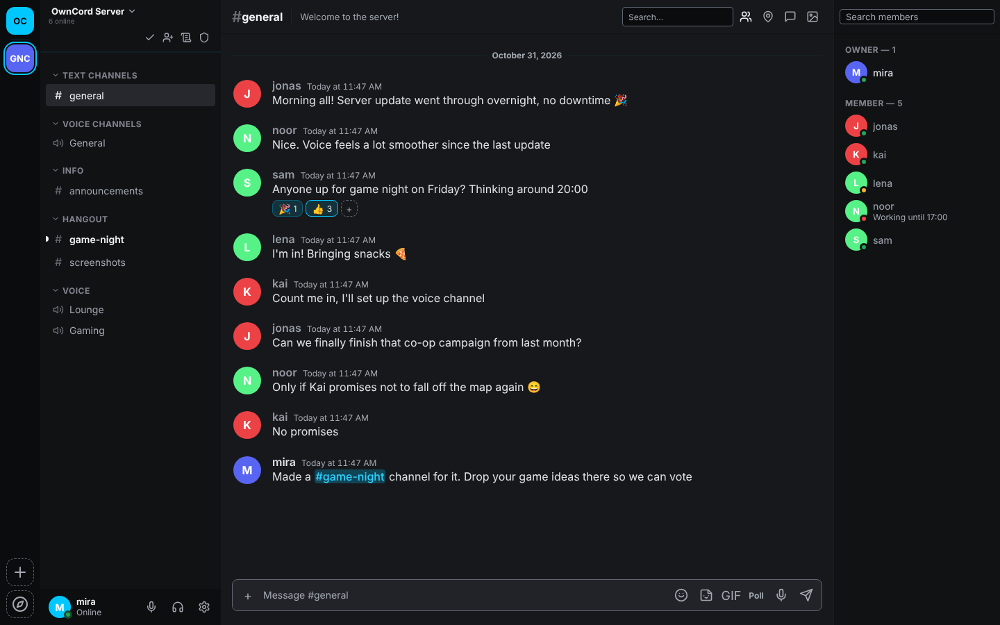
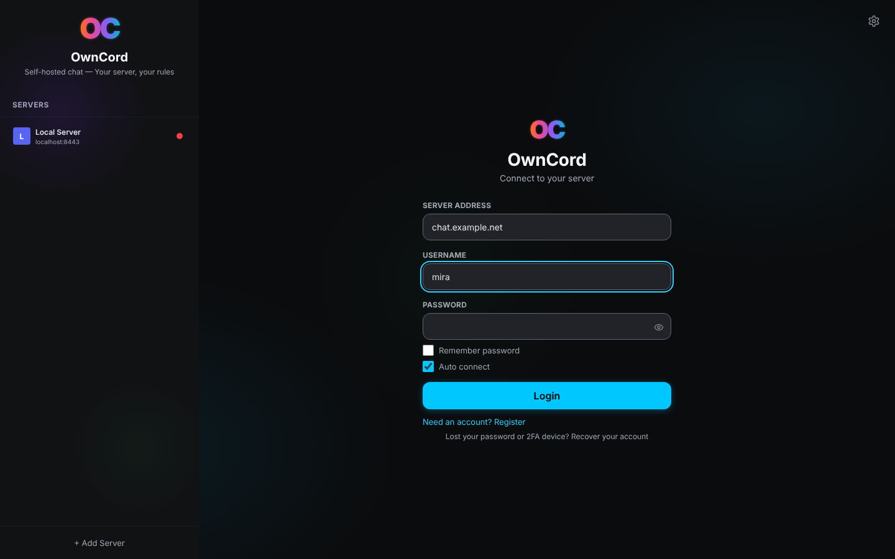
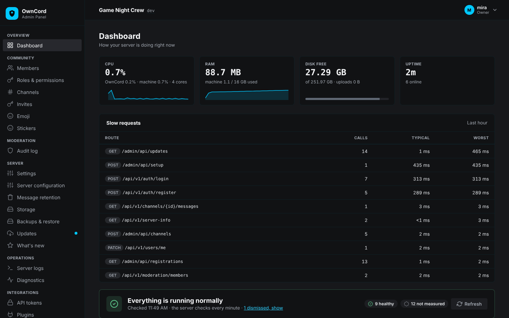

# OwnCord

OwnCord is a self-hosted chat app I build for me and my friends. It has text
channels, voice and video, and a server you own.

> **Beta, and a hobby project.**
> I build this for fun and run it for a small group of friends. It is not a
> product. There is no support promise, and it is not production-ready. Expect
> rough edges, fast changes and the odd breaking change.
>
> Do not use it for anything sensitive.

OwnCord has two parts:

- a **Go server**, which you run on a spare computer or a VPS
- a **desktop app**, built with Tauri, which your friends install. There is
  also an experimental **Android app**, and the server can host a **browser
  client** for people who do not want to install anything.

You start the server, give your friends an invite code, and that is it.

  

  
  

## Start here

| I want to…                              | Read                                                         |
| --------------------------------------- | ------------------------------------------------------------ |
| Get a server running quickly            | [docs/quick-start.md](docs/quick-start.md)                   |
| Run the server on Linux with Docker     | [docs/deployment.md](docs/deployment.md#docker-linux)        |
| Let friends connect without router work | [docs/tailscale.md](docs/tailscale.md)                       |
| Open ports on my router myself          | [docs/port-forwarding.md](docs/port-forwarding.md)           |
| Install the desktop app on Linux        | [docs/linux-install.md](docs/linux-install.md)               |
| Change a server setting                 | [docs/server-configuration.md](docs/server-configuration.md) |
| Know what the beta does not do          | [docs/known-limitations.md](docs/known-limitations.md)       |
| Build it myself or contribute           | [docs/contributing.md](docs/contributing.md)                 |
| See how it is built                     | [docs/architecture/](docs/architecture/README.md)            |
| Find any other document                 | [docs/README.md](docs/README.md)                             |

## What works today

| Area            | Status          |
| --------------- | --------------- |
| Text chat       | Working in beta |
| Voice and video | Working in beta |
| Admin panel     | Working in beta |
| Browser client  | Working in beta |
| Android app     | Experimental    |

Security is reviewed in regular passes. Each review is a dated audit, listed in
[docs/README.md](docs/README.md#audits).

## Features

- **Chat.** Channels, direct messages, forums with threads, polls, stickers,
  custom emoji and voice messages. History is saved, with retention per
  channel.
- **Voice and video.** Runs on [LiveKit](https://livekit.io), which the server
  can download and run for you. Calls are end-to-end encrypted. Screen
  sharing, and optional passwords on voice channels.
- **Several servers.** A server rail like Discord's, with Home for your direct
  messages.
- **Bring your Discord history.** The admin panel imports a Discord channel
  export, with the original authors on each message.
- **Files.** Uploads with inline images and video, a Media panel per channel
  and a My uploads page.
- **Your look.** Themes, animated avatars and your own CSS.
- **Who can join.** Closed, invite, approval or open registration, with
  invite codes and role permissions.
- **Moderation and admin.** Reports, appeals, warnings and timeouts, and a web
  admin panel for logs, backups, retention, the audit log and updates.
- **Accounts.** Two-factor sign-in, a recovery kit, several devices, and
  saved credentials in the system keyring.
- **Updates.** The desktop and Android apps update themselves and check each
  update's signature first.

Optional extras (GIF picker, experimental WASM plugins) are in
[docs/server-configuration.md](docs/server-configuration.md).

## Platform support

| Part          | Windows x64     | Windows ARM64   | Linux x64            | Linux ARM64          |
| ------------- | --------------- | --------------- | -------------------- | -------------------- |
| Server        | Yes             | Yes             | Yes                  | Yes                  |
| Desktop app   | Yes (installer) | Yes (installer) | Yes (AppImage, .deb) | Yes (AppImage, .deb) |
| Docker server | No              | No              | Yes                  | Yes                  |

- **Android (experimental):** each release has an arm64 APK. Android asks once
  to allow installs from OwnCord; after that the app offers updates itself.
- **Browser client:** the server can host the client itself. Turn on **Host a
  browser client** in the admin panel (Server configuration). It is off by
  default.
- **Docker:** the image is `ghcr.io/j3vb/owncord-server`, one tag for both
  `amd64` and `arm64`.

## Quick start

1. Download the server for your system from
   [Releases](https://github.com/J3vb/OwnCord/releases) and start it.
2. Open `https://localhost:8443/admin` and follow the setup wizard. It asks
   for the **setup token** the server printed when it started.
3. Make an invite code on the admin panel's **Invites** page and send it to
   your friends.

The desktop app asks once to trust the server's own certificate, then
remembers it. Docker, ports, voice and every other step:
[docs/quick-start.md](docs/quick-start.md).

## How it is built

A Go server (REST, WebSocket and LiveKit, over SQLite) and a Tauri desktop app
with a TypeScript front end. Most of the code is written with AI tools; quality
comes from automated checks and from daily use by me and my friends.
[docs/ai-workflow.md](docs/ai-workflow.md) says who does what, and
[docs/architecture/](docs/architecture/README.md) shows how it fits together.

## Getting help

There is no support promise (see the note at the top). But each kind of
message has a right place:

| What you have                 | Where it goes                                                                               |
| ----------------------------- | ------------------------------------------------------------------------------------------- |
| A bug you can reproduce       | [Issues](https://github.com/J3vb/OwnCord/issues/new/choose)                                 |
| A question about setup or use | [Discussions → Q&A](https://github.com/J3vb/OwnCord/discussions/categories/q-a)             |
| An idea or feature request    | [Discussions → Ideas](https://github.com/J3vb/OwnCord/discussions/categories/ideas)         |
| A security problem            | [Private advisory](https://github.com/J3vb/OwnCord/security/advisories/new), never an issue |

Security policy: [SECURITY.md](SECURITY.md) and [docs/security.md](docs/security.md).

## Contributing

Branch from `dev` and open a pull request into `dev`. Setup, building from
source, running the checks and the release procedure are in
[docs/contributing.md](docs/contributing.md).

## License

AGPL-3.0
