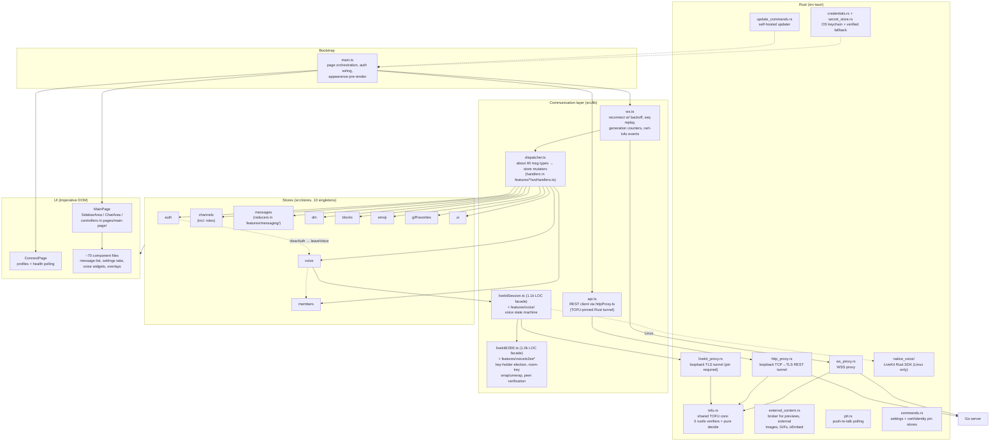

# Client Architecture (Tauri)

**Verified against:** `origin/dev` at `ac6ffc4e`, 2026-10-13.

This page maps the desktop client as it is built today: its modules, stores,
Rust commands and test tooling. Read it before you add a module or move code
between layers. For how each view should _behave_, see [ux/](ux/README.md).

The client is built on Tauri v2. It has two halves:

- a TypeScript webview: about 90,000 lines of non-test source, plain
  TypeScript with no UI framework;
- a Rust backend: about 23,000 lines across 39 source files in
  `src-tauri/src/` (including the Linux `native_voice/` module).

State lives in a hand-written reactive store (`src/lib/store.ts`). It uses
immutable updates, batches notifications in a microtask, and lets callers
subscribe to a selected slice. Components are factory functions that return
`{ element, mount, destroy }`, built with the `@lib/dom` helpers. A small
two-page state machine in `src/main.ts` (`activePage` and `navigate()`)
switches between the Connect page and the Main page.

> `docs/client-architecture.md` is a redirect page kept for old links. This
> document is the client architecture reference. The abandoned SolidJS code
> that used to live under `src/components/solid/` was removed (audit
> A-2026-07-12, closed 2026-07-19).

## D7 — Module map

**What this shows.** In the normal case, data flows one way:

1. a WebSocket frame arrives at the Rust `ws_proxy`;
2. `ws.ts` parses it;
3. `dispatcher.ts` routes it to store mutators;
4. subscribed components re-render.

The 10 stores in the diagram are the ones in `src/stores/`. Some features also
keep a domain store of their own (`src/features/moderation/store.ts`,
`src/features/safety/store.ts`, `src/features/message-requests/store.ts`);
the dispatcher is their only writer from the WebSocket too.

All three paths to your own server — WebSocket, REST and LiveKit — end their
TLS inside Rust proxies that share one TOFU module (`tofu.rs`). The WebSocket
and HTTP proxies use a "capture, then decide" verifier. The LiveKit proxy
refuses to start without an existing pin. Deciding never writes a pin: a first
connection is _rejected_ and shown to the user as a blocking trust prompt.
Only the user's Accept stores the pin. (The old behaviour that pinned silently
on first use was removed in the 2026-07-22 security fixes.)

Content that other users link to takes a different path: the
`external_content.rs` broker. It reaches only public addresses and never
carries the session token. On Linux, voice and video run in the Rust
`native_voice/` module instead of the webview
([voice-e2ee.md](voice-e2ee.md)).

The dashed edges between stores mark cross-store coupling
(auth → voice → members). This is known structural debt that is not yet
scheduled.

### Key mechanisms

| Concern             | Where                                                                                    | How                                                                                                                                                                                                                                                                                                                                                                                                                                                                                                                                                                                                                                               |
| ------------------- | ---------------------------------------------------------------------------------------- | ------------------------------------------------------------------------------------------------------------------------------------------------------------------------------------------------------------------------------------------------------------------------------------------------------------------------------------------------------------------------------------------------------------------------------------------------------------------------------------------------------------------------------------------------------------------------------------------------------------------------------------------------- |
| Reconnect           | `src/lib/ws.ts`                                                                          | Exponential backoff (cap 30s), heartbeat 30s, `last_seq` replay + bounded dedup set, generation counter invalidates stale listeners                                                                                                                                                                                                                                                                                                                                                                                                                                                                                                               |
| Cert trust          | `src-tauri/src/tofu.rs` (shared by `ws_proxy.rs`, `http_proxy.rs`, `livekit_proxy.rs`)   | TOFU with explicit consent: fingerprints stored per host in `certs.json`, but _deciding never writes a pin_ — first use and mismatch both reject the connection and emit a `cert-tofu` event; the TS side shows a blocking modal (`CertMismatchModal.ts`) and only an explicit Accept stores/updates the pin — except a routine public-CA renewal, where the pinned and the new leaf are both web-PKI valid for the same DNS name (recorded in `cert_web_pki.json`) and `tofu::evaluate` re-pins silently. The updater uses a fourth, host-scoped verifier (pin for the OwnCord host, WebPKI for GitHub).                                         |
| Voice E2EE identity | `src/lib/net/identity.ts`, `src-tauri/src/credentials.rs` (key) and `commands.rs` (pins) | Long-term ECDSA identity key in the OS keyring (`identity:{userId}@{host}`); peer identity keys pinned in `identity_pins.json`; changed peer key that signed the announce → accepted and re-pinned, with a persistent notice and a "key changed" badge carrying the safety number; missing key or bad signature → blocked, identity-mismatch modal                                                                                                                                                                                                                                                                                                |
| Credentials         | `src-tauri/src/credentials.rs`                                                           | OS keychain per host; password field `serde(skip)` so it never crosses IPC back to JS — the frontend gets `has_password` and shows a placeholder, and `login_with_saved_password` does the login inside Rust. `save_credential` preserves the stored password unless `clear_password` is set, so a re-save never has to resend it                                                                                                                                                                                                                                                                                                                 |
| Multi-server        | `src/lib/presence/profiles.ts` + `src/main.ts`                                           | Server profiles w/ 15s health polling and auto-connect; one active connection, quick-switch replaces WS + tunnels                                                                                                                                                                                                                                                                                                                                                                                                                                                                                                                                 |
| HTTP capability     | `src-tauri/capabilities/default.json`                                                    | `http:allow-fetch` is the only URL-scoped identifier (the other `fetch_*` commands take an already-validated `ResourceId`). It allows only `http://127.0.0.1:*`, the loopback TOFU proxies, and denies https loopback. Link previews and other external content no longer need a wildcard: they go through the `external_content.rs` broker instead. Background: [docs/plans/tauri-capability-narrowing.md](../plans/tauri-capability-narrowing.md)                                                                                                                                                                                               |
| Updates             | `src/lib/net/updater.ts` + `update_commands.rs`                                          | Endpoint derived from the connected server URL, https-only, TLS pinned to TOFU fingerprint, minisign-verified. On Windows the NSIS pre-install hook (`src-tauri/nsis/hooks.nsh`) waits for the old executable to unlock before the installer overwrites it, so a first update after install cannot skip the copy and relaunch the old binary                                                                                                                                                                                                                                                                                                      |
| Settings            | `commands.rs` + `src/lib/prefs/preferences.ts`                                           | Split persistence: Rust store (`settings.json`, key-allowlisted) _and_ raw `localStorage` for UI prefs/themes                                                                                                                                                                                                                                                                                                                                                                                                                                                                                                                                     |
| Local stores        | `src-tauri/src/json_store.rs`                                                            | `settings.json`, `certs.json`, `cert_web_pki.json`, `identity_pins.json` and `credential_fallback.json` in the app data dir. Every save writes a temp file, fsyncs it and renames it over the original, so a crash never leaves a torn file; clippy bans truncating writers (`fs::write`, `File::create`, `OpenOptions::truncate`, `tokio::fs::write`) elsewhere. A file that does not parse is copied to `<name>.corrupt-<unix seconds>` and logged; the two pin stores then fail closed until it is removed and the client restarted, the others start empty. A file that cannot be read, or whose copy fails, never opens, whatever the store. |
| Theming             | `src/lib/prefs/themes.ts` + `styles/tokens.css`                                          | CSS custom properties; 4 built-in themes + custom overrides                                                                                                                                                                                                                                                                                                                                                                                                                                                                                                                                                                                       |
| GIF picker          | `src/lib/media/gifProvider.ts` + `components/GifPicker.ts`                               | Calls the user's own server (`/api/v1/gif/*`) through `api.ts` — no provider API key in the bundle. Server answers `503 GIF_DISABLED` when unconfigured: the picker shows "GIFs are not enabled on this server" and `onUnavailable` disables the composer's GIF button (with a `title`/`aria-label` reason) instead of failing silently. Returned media URLs are still pinned to the `klipy.com` CDN, and the GIF images themselves are fetched through the external-content broker.                                                                                                                                                              |

#### Lifecycle ownership

Timers and listeners are owned through two primitives (B7-11):

- **`Disposable`** (`src/lib/disposable.ts`) owns a component, overlay or
  render lifetime: one `AbortController` whose signal registers listeners,
  plus cleanups. `addCleanup` returns nothing, so a timer re-armed on every
  keystroke registers _one_ cleanup that clears the current handle. `destroy`
  runs cleanups without per-cleanup isolation, so a page-level disposer list
  that must survive a throwing cleanup (`MainPage`'s `unsubscribers`) stays an
  array. A per-render child is a child `Disposable` the parent destroys.
- **`SessionScope`** (`src/lib/net/sessionScope.ts`) owns session-bound async
  work: `fork()` per request, isolated cleanups, and completions rejected after
  the session ends. A request that must outlive the session it was sent from
  (the logout revocation) runs on a detached scope instead.

`tests/unit/lifecycle-ownership.test.ts` enforces four lexical rules from the
syntax tree, each with an exact allowlist that fails on a stale entry, so the
lists only shrink: **R1** a `window`/`document`/`navigator.*` listener carries a
`signal` or `once` (or is an app-lifetime singleton with a reason); **R2** an
interval keeps its handle and is cleared in its own file; **R3** a timeout keeps
its handle (or a signal owns it through `setOwnedTimeout`); **R4** `new
AbortController` appears only in the primitives and named cancellation tokens.
`tests/helpers/lifecycle.ts` fails a unit test that ends with a bare
`window`/`document` listener or a real interval alive, unless its file is on the
shrink-only `tests/lifecycle-guard-baseline.json`.

The lexical rules cannot see a listener on a signal that outlives what it
served, so a CDP soak proves the runtime half
(`tests/e2e/support/lifecycle-probe.ts`). After forced GC it counts listeners,
nodes, documents, live `AbortController`s, live intervals and timeouts, open
sockets and peer connections, live tracks and `AudioContext`s, and heap. The bar
is no growth after warm-up: every count's slope is at most 0.05 per cycle
(documents, intervals and `AudioContext`s exactly flat, the one context being the page-lifetime notification sound; sockets, peer connections and tracks exactly 0 at every sample), both across pages at the same page age
and within one page (cycles 6 and 9, after that page's reconnect). A nodes
series also passes on a net move of at most 2 (listeners, abort controllers and
timeouts: 1) in either series, because a
detached node can be in flux at one sample even after the settle loop (a
1-node move in a two-sample page series is a slope of 1/3). That is a blind
spot: every page is two samples however long the soak runs, so page-scoped node
growth of up to 2 that the re-login navigation releases passes. A phase-series
node leak grows past the tolerance and still fails. Heap
stays within 1.10× and 25 KB per cycle at equal page age. It runs 20 cycles on
every `client-fullstack` PR (`tests/e2e/fullstack/long-session.spec.ts`), 10 cycles
over WebView2 in `client-native` (`tests/e2e/native/long-session.spec.ts`), and
200 cycles plus 30 idle-connected minutes, in which every count must hold
exactly and heap grow at most 100 KB per minute, through `npm run test:e2e:soak` (the `long-session-soak` job in
`nightly-test-depth.yml`). The recorded runs are in
[b7-0-client-baseline-2026-09-19.md](../archive/plans/b7-0-client-baseline-2026-09-19.md).

A **native voice backend** (Linux, LiveKit in `src-tauri/`) keeps the same rules
on the TypeScript side, plus three that exist because the resource lives across
IPC: a Tauri `listen()` subscription is registered on the voice attempt's owner
and an unlisten that resolves after that owner is gone is called at once (the
`retainListener` shape in `platform/desktop/pushToTalkService.ts`); every native
handle (room, track, IPC channel) is released in the same teardown that
disconnects the web room, behind the `livekitSession` facade, never a second
teardown path; and native open rooms, live tracks and event channels are
reported through `getSessionDebugInfo`, where the bar is 0 outside a call and
no growth across cycles, because the webview counters cannot see Rust memory.

### Quality tooling

The client has about 540 test files, roughly 208,000 lines (about 2.3× the
source): 411 Vitest files and 132 Playwright specs.

- **Vitest** unit and integration tests, with coverage floors that block CI
  (70% for branches, functions and lines; the statements floor comes from
  `Client/coverage-floor.json`).
- **Playwright web E2E**, two blocking jobs:
  - `client-e2e-parity` runs the full 694-test suite against the production
    bundle;
  - `client-e2e` always runs the smoke set against the Vite dev
    server; the full suite runs only in `client-e2e-parity`.
- **Native Tauri suite**, the `client-native` job on `windows-latest` (a
  70-minute budget, on pull requests to `main` and `dev`). It builds the app,
  runs the `native-core` Playwright project, then the auth, UI and
  native-extra projects listed in `docs/testing-behavior.md`, then the
  signed-NSIS install and relaunch script.
- **Installed-artifact smoke**, `client-artifact-smoke.yml`, on four targets.
  It installs the Windows x64/ARM64 NSIS and the Linux x64/ARM64 AppImage and
  deb bundles, each on its own architecture, and drives install, boot,
  connect, media and recovery. It runs nightly on unsigned builds, and in
  `release.yml` before `publish` on the signed bundles. There it also updates
  from the previous release and rolls back.
- **Stryker mutation testing**: a sharded nightly baseline
  (`nightly-test-depth.yml`), plus a pull-request step for the
  `permissions.ts` hotspot when that code changes.
- **Static checks**: oxlint, type-checked ESLint, Prettier, Knip (blocking)
  and strict `tsc`.
- **Rust**: the `cargo test --lib` suite lives beside the code in 33 of the 39
  source files. It blocks CI together with `cargo clippy -D warnings`.

**Source of truth:** `src/main.ts`, `src/lib/dispatcher.ts` (+ `src/features/*/wsHandlers.ts`), `src/lib/ws.ts`,
`src/lib/api.ts`, `src/lib/store.ts`, `src/stores/*.store.ts` (+ the `messages.store.ts` reducers in `src/features/messaging/`),
`src-tauri/src/lib.rs`, `src-tauri/tauri.conf.json`.
