# Data Model

**Verified against:** `origin/dev` at `ac6ffc4e`, 2026-10-13 (migrations
001–059).

This page shows how OwnCord's database tables relate to each other, grouped by
area. Read it to find where a kind of data lives before you change a query or
add a migration. For every column, see [`docs/schema.md`](../schema.md), whose
table list is generated from the migrated schema.

The schema is the ordered migration set `Server/migrations/001–059`. The
migrations are embedded with `go:embed`, applied by the runner in
`Server/db/migrate.go`, and recorded in the `schema_versions` table. SQLite is
the only supported engine: start-up refuses any other `database.type`
(`Server/internal/app/database.go`).

## D5 — Entity-relationship overview

There are 50 application tables. (`docs/schema.md` lists 57, because it also
counts `schema_versions`, `sqlite_sequence` and the full-text search tables
behind `messages_fts`.) The diagram shows the relationships, not every column.

```mermaid
erDiagram
    %% ── Identity & access ──
    roles ||--o{ users : "role_id"
    users ||--o{ sessions : "user_id"
    users ||--o{ api_tokens : "user_id"
    roles ||--o{ channel_overrides : "role_id"
    channels ||--o{ channel_overrides : "channel_id"
    users ||--o{ channel_user_overrides : "user_id"
    channels ||--o{ channel_user_overrides : "channel_id"
    users ||--o{ user_blocks : "blocker_id / blocked_id"
    users ||--o{ invites : "created_by / redeemed_by"
    invites ||--o{ invite_redemptions : "invite_id"

    %% ── Second factor & recovery ──
    users ||--o{ partial_auth_challenges : "user_id"
    users ||--o| pending_totp_enrollments : "user_id (PK)"
    users ||--o{ totp_used_codes : "user_id"
    users ||--o{ totp_recovery_codes : "user_id"
    users ||--o| recovery_kits : "user_id (PK)"
    users ||--o| recovery_assists : "user_id (PK)"

    %% ── Messaging ──
    channels ||--o{ messages : "channel_id"
    users ||--o{ messages : "user_id"
    messages ||--o{ messages : "reply_to"
    messages ||--o{ attachments : "message_id"
    messages ||--o{ reactions : "message_id"
    users ||--o{ reactions : "user_id"
    messages ||--o{ message_mentions : "message_id"
    users ||--o{ message_mentions : "mentioned_user_id"
    users ||--o{ read_states : "user_id"
    channels ||--o{ read_states : "channel_id"
    users ||--o{ message_delivery_receipts : "user_id"
    users ||--o{ nsfw_acknowledgements : "user_id"
    channels ||--o{ nsfw_acknowledgements : "channel_id"
    users ||--o{ gif_favorites : "user_id"

    %% ── Direct messages and message requests (channels with type='dm') ──
    channels ||--o{ dm_participants : "channel_id"
    users ||--o{ dm_participants : "user_id"
    channels ||--o{ dm_open_state : "channel_id"
    users ||--o{ dm_open_state : "user_id"
    users ||--o{ message_requests : "sender_id / recipient_id"
    channels ||--o{ message_requests : "channel_id"
    users ||--o{ trusted_senders : "recipient_id / sender_id"

    %% ── Voice ──
    users ||--o| voice_states : "user_id (PK)"
    channels ||--o{ voice_states : "channel_id"

    %% ── Moderation ──
    reports ||--o{ report_events : "report_id"
    reports ||--o{ report_evidence : "report_id"
    reports ||--o{ report_notes : "report_id"
    users ||--o{ moderation_actions : "target_id"
    moderation_actions ||--o| appeals : "action_id"
    users ||--o{ appeals : "appellant_id"

    %% ── Retention ──
    channels ||--o| channel_retention : "channel_id (PK)"

    %% ── Storage & push ──
    users ||--o| user_storage : "user_id (PK)"
    users ||--o{ push_subscriptions : "user_id"

    %% ── Plugins ──
    plugins ||--o{ plugin_kv : "plugin_id"

    %% ── Standalone (no FK edges) ──
    events
    settings
    audit_log
    login_attempts
    rate_lockouts
    emoji
    erasure_jobs
    retention_runs
    retention_revision
    member_generation

    users {
        int id PK
        int role_id FK
        string username
        string password "bcrypt hash"
        bool banned
    }
    roles {
        int id PK
        string name
        int permissions "bitfield, bits 0-30"
        int position
    }
    channels {
        int id PK
        string name
        string type "text | voice | announcement | dm (trigger-enforced)"
        bool is_group "028: marks a group DM"
    }
    messages {
        int id PK
        int channel_id FK
        int user_id FK
        int reply_to FK
        string content
    }
    attachments {
        string id PK "UUID"
        int message_id FK
        int uploader_id "added by 010"
    }
    events {
        int seq PK "AUTOINCREMENT, hub seq seeded from MAX(seq)"
        string type
        string payload
    }
```

### Domain notes

**Identity and access.** Tables: `roles`, `users`, `sessions`, `api_tokens`,
`channel_overrides`, `channel_user_overrides`, `user_blocks`, `invites`,
`invite_redemptions`, `login_attempts`, `rate_lockouts`.

- Sessions store only SHA-256 hashes of their tokens.
- `api_tokens` (018) are long-lived bearer credentials, minted by the owner and
  stored hashed. They live outside the session table on purpose.
- Permissions are a bitfield on `roles.permissions`. Channel overrides use
  Discord's rule, `(role &^ deny) | allow`. `channel_user_overrides` (024) is
  a final per-user layer on top of the role layer.
- `users` gained `identity_public_key` (017) for voice E2EE identity pinning,
  `display_name`, `about` and `custom_status` (027), and `registration_status`
  (034).
- `rate_lockouts` (011) keeps rate-limiter lockouts across restarts.
- `invite_redemptions` (055) records each use of an invite.

**Second factor and recovery.** Tables: `partial_auth_challenges`,
`pending_totp_enrollments`, `totp_used_codes`, `totp_recovery_codes` (032),
`recovery_kits` (035), `recovery_assists` (036). Each table stores its secrets
in its own way. Partial-auth tokens and used TOTP codes are SHA-256 digests.
Pending enrolment secrets are AES-GCM ciphertext. Emergency TOTP recovery codes
are bcrypt hashes. Only `recovery_kits` and `recovery_assists` use argon2id
verifiers. See [trust-model.md](../trust-model.md), "Account
recovery".

**Messaging.** Tables: `channels`, `messages`, `attachments`, `reactions`,
`read_states`, `message_mentions`, `emoji`, `message_delivery_receipts`,
`nsfw_acknowledgements`, `gif_favorites`.

- `message_mentions` (022) stores the `@username` mentions the server
  resolved for each message. `messages.mentions_everyone` flags an allowed
  `@everyone` or `@here`. Together they drive `read_states.mention_count`,
  the unread badge.
- `channels.type` must be `text`, `voice`, `announcement` or `dm`. INSERT and
  UPDATE triggers enforce this (013, extended by 016 for `announcement`).
  Announcement channels read like text channels, but posting needs
  `MANAGE_MESSAGES`.
- `attachments.uploader_id` (010) backs upload-ownership checks.
- `message_delivery_receipts` (051) lets the server recognise a resent message
  so a retry is not stored twice.
- `nsfw_acknowledgements` (047) records that a user accepted a channel's NSFW
  label (`channels.nsfw`, 025).

**Direct messages and message requests.** Tables: `dm_participants`,
`dm_open_state`, `message_requests`, `trusted_senders`.

- A DM is a `channels` row with `type='dm'`. `dm_participants` and
  `dm_open_state` (009) track who is in it and whether each user has it open.
- `channels.is_group` (028) marks a group DM, so it stays a group when people
  leave.
- `message_requests` and `trusted_senders` (046) hold DMs from people the
  recipient has not accepted yet.

**Voice.** `voice_states` has one row per user (`user_id` is the primary key),
so a user is in at most one voice channel.

**Moderation.** Tables: `reports`, `report_events`, `report_evidence`,
`report_notes` (048), `moderation_actions` (049), `appeals` (050).

**Real-time replay.** `events` is the cold tier of the 3-tier reconnect replay
([websocket.md](websocket.md)). The async `EventPersister` writes it, and a
retention sweep prunes it. At start-up the hub seeds its sequence counter from
`MAX(events.seq)`, so sequence numbers keep rising across restarts.

**Data lifecycle.** Tables: `erasure_jobs` (037), `channel_retention`,
`retention_runs` (039), `retention_revision` (053), `member_generation` (057).
These back account erasure and message retention; see
[data-lifecycle.md](data-lifecycle.md).

**Storage and push.** `user_storage` (044) holds each user's upload quota
usage. `push_subscriptions` (045) holds Web Push endpoints.

**Plugins.** `plugins` and `plugin_kv` (015). `plugin_kv` is a key/value
store per plugin, keyed by `(plugin_id, key)`.

**Operations.** `settings` is a generic key/value table, read by the admin
panel and the WebSocket hub (through `db.GetSetting`). Migration 003 rebuilds
`audit_log` through a temporary `audit_log_v6` table; only `audit_log` exists
at runtime. Migration 029 dropped the unused `sounds` table.

### How the schema is accessed

The `Server/db` package is the single data layer. Its methods live in
`*_queries.go` and most of them call the sqlc-generated `Server/db/dbgen` code,
so sqlc is the type-checked query layer. A documented set of raw queries stays
hand-written where sqlc cannot express them: variable-length `IN` lists,
full-text search, multi-statement transactions, and PRAGMA or VACUUM. See
[plans/sqlc-adoption.md](../plans/sqlc-adoption.md).

Code that uses the database depends on small interfaces that `*db.DB`
satisfies, not on the concrete type:

- `service.Store` for the service layer;
- `ws.EventStore` for cold-tier replay;
- `plugin.PluginStore` for the plugin registry.

D3 removed the old `store` package. Tests now run against a real in-memory
SQLite database. Some `Server/api` handlers and the `Server/admin` package
still take a raw `*db.DB` instead of going through the service layer. That is
the remaining clean-up work (audit A-2026-07-06; per-file detail in
[server-boundaries.md](server-boundaries.md)).

**Source of truth:** `Server/migrations/*.sql` (schema), `Server/db/migrate.go`
(runner), `Server/db/*_queries.go` (live queries), `Server/service/datastore.go`
(service interface), `sqlc.yaml` + `Server/db/dbgen/` (generated query layer).
