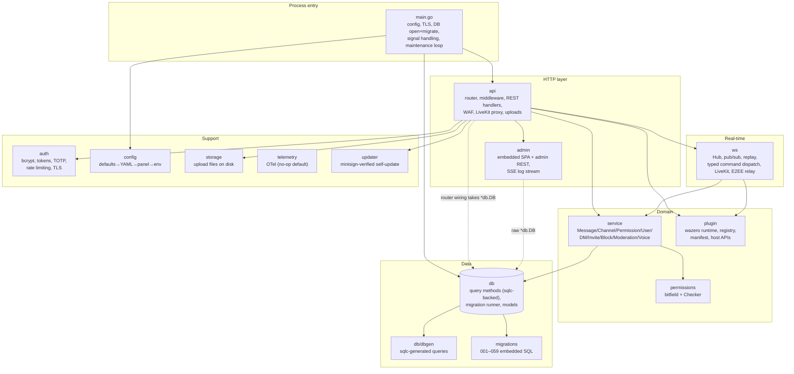
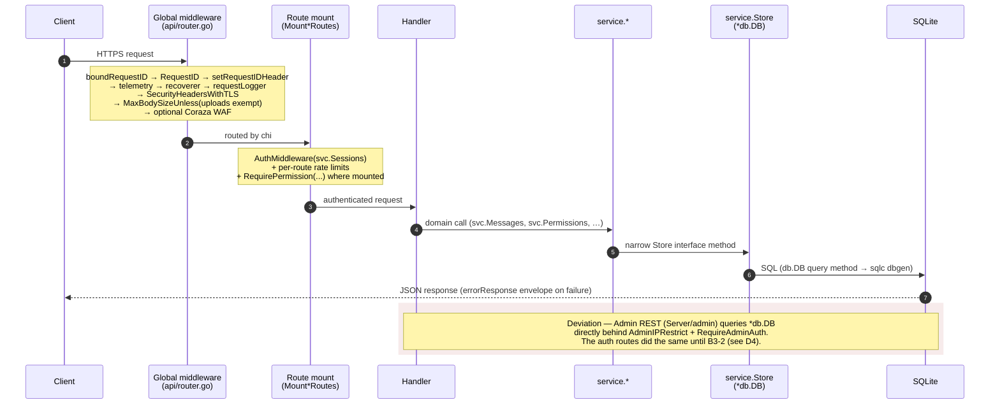

# Server Architecture

**Verified against:** `origin/dev` at `ac6ffc4e`, 2026-10-13

This page maps the Go server: its packages, how a REST request flows through
them, and the pattern used to move a family of routes behind the service
layer. Read it before you change where server code lives.

The server is a single Go binary (`github.com/J3vb/OwnCord/Server`, Go 1.27).
Its main building blocks are:

- pure-Go SQLite (`modernc.org/sqlite`, no CGO);
- the chi router and `github.com/coder/websocket`;
- LiveKit for voice;
- Wazero for plugins, behind a build tag;
- optional OpenTelemetry (`-tags otel`).

By `wc -l`, the code is about 98,000 lines of production Go (generated sqlc
code excluded) and about 188,000 lines of tests.

## D2 — Package map

[server-boundaries.md](server-boundaries.md) (B3-0) lists which packages may
import `db` and what every file above the domain layer does with it. The
`db-import-boundary` rule in `Server/invariants/` enforces that list.

**What this shows.** The layering is `api → service → db`. (D3 removed the
old `store` layer.) The `service` layer depends on a narrow `service.Store`
interface that `*db.DB` satisfies. `ws` and `plugin` depend on their own small
interfaces (`ws.EventStore`, `plugin.PluginStore`) in the same way. The `db`
package's query methods call the sqlc-generated `db/dbgen` code, so sqlc is the
type-checked query layer.

The two dashed edges mark where code above the service layer still holds the
raw `*db.DB` (this paragraph checked against `origin/dev` at `cab72959`,
2026-10-27):

- In `api`, no non-test file but `router.go` names `*db.DB` in a signature, and
  there it is router wiring (`NewRouter` and the health and metrics routes).
- Seventeen `admin` files import `db`. Most only name its types. The ones that
  need the handle itself are the backup, archive, update, log-level,
  log-stream and config-override files, which
  [server-boundaries.md](server-boundaries.md) classes as `boundary`.

That table classes all 83 files above the domain layer as `adapter` (55) or
`boundary` (28), and none as `move`. No service-layer move is listed as open
work there. The per-file table is in
[server-boundaries.md](server-boundaries.md). See also
[data-model.md](data-model.md).

`app.StartRuntime` (`Server/internal/app/hub.go`) is the _composition root_:
the one place that builds the long-lived parts and wires them together. It
builds the persistent rate limiter, `service.New`, the LiveKit client and its
optional managed subprocess, and the `ws.Hub` (through a validated
`ws.HubOptions`). It also builds the `AuthService`, the updater and takes the
one upload `storage.Storage`, runs `wireAuth` (the service setters that need the
hub or the store) before the hub's dispatch goroutine starts, and returns an
`api.Runtime`.

`api.NewRouter` (`Server/api/router.go`) then only mounts: it builds the global
middleware chain, mounts the routes and the admin and plugin-admin handlers
over the collaborators in the `Runtime`, and constructs nothing of its own. The
rate-limiter cleanup ticker is an app-owned goroutine (`limiter-cleanup`), and
the TOTP key is loaded by the `totp-key` stage. `app.startRouter` calls it.
`main.go` does only process-level wiring: config, TLS, the database, event
persistence, the HTTP server and shutdown.

The `plugin` package is experimental and compiled out of release binaries.
[plugins.md](plugins.md) records that boundary: what exists, what carries no
promise, and which core concerns will never move behind it.

**Source of truth:** `Server/main.go`, `Server/api/router.go`, package import
graph (`go list -deps`), `Server/service/datastore.go`, `sqlc.yaml`.

## D3 — REST request lifecycle

**What this shows.** `NewRouter` builds the global middleware chain when it
mounts the routes (`routerMiddleware` in `Server/api/router.go`). The order is
a security property, so keep it as written.

**Client IP.** chi's `middleware.RealIP` is left out on purpose. The client IP
comes from `clientip.Resolve`, which trusts `X-Real-IP` and `X-Forwarded-For`
only from the configured trusted proxies. So spoofed headers are not trusted by
default. The same resolver feeds the access log, the WebSocket handshake log
and the `ws_connect` audit row. Behind the recommended reverse proxy, every
path records the real client rather than the proxy.

**Authentication** is a bearer token. The server stores only a SHA-256 hash of
each opaque token.

**Authorization** is checked at two levels on purpose (D13):

- `RequirePermission` middleware gates the two routes that have no channel:
  the invite routes and the connectivity diagnostics. It checks server-wide
  role permissions through `permissions.HasServerPerm`. Channel overrides are
  not consulted, because a per-channel allow must never open a server-wide
  gate.
- Anything channel-scoped is checked in the service layer through
  `svc.Permissions` / `permissions.Checker`. That resolves overrides and fails
  closed if it cannot read them.

The shaded region marks where admin code still goes straight to the database.
The auth routes left that region in B3-2 (`MountAuthRoutes(r, authSvc,
requireAuth, …)` → `service.AuthService` → `Store`).

**Source of truth:** `Server/api/router.go`, `Server/api/middleware.go`,
`Server/api/auth_handler.go`, `Server/admin/middleware.go`,
`Server/permissions/`, `Server/service/`.

## D4 — The vertical-slice pattern (B3-2; the rule for B3-8)

This section is for contributors moving a family of routes behind the service
layer. The auth slice was the first family moved from "the handler owns the
database" to `api → service → db`, behind an interface owned by the caller. A
frozen set of characterization tests proved nothing changed. B3-8 repeats this
for each family.

Do the steps below in order. Make each one its own commit, so a reviewer can
read the move separately from the rewrite.

1. **Characterize first, in its own PR.** Table tests over the mounted
   router pin today's behaviour per route: status, code and message of every
   refusal, session shape, rate-limit accounting, DB-fault paths. A row that
   finds a defect is pinned as-is with a `// known:` comment and a ledger
   entry — the slice moves behaviour, it does not fix it. Record per-file
   statement coverage of the handler files.
2. **List the gates, then grep the rows.** Before writing the interface,
   list every handler statement that runs _before_ the body decode (policy
   reads, per-user lockouts, "already enrolled", challenge lookups) and grep
   the characterization file for malformed-body rows per route (`{not json`).
   A route with such a row keeps its gate as a separate interface method,
   ahead of the decode; a route without one decodes first, the service runs
   the gate in the original order, and the corner case (garbage input behind
   a gate now gets 400 instead of the gate's status) goes in the evidence
   block. This was the awkward step on the auth slice: `/register` had the
   rows (→ `RegistrationPolicy`), the password-confirmation routes did not.
3. **Interface beside the consumer** — `api/<family>_deps.go`, exported,
   one method per route call, named in the service's input/result types
   (`service.Principal`, `service.<X>Input`, `service.<X>Result`), never in
   `db` types, so the file adds no `db` importer. Method count ≤ the distinct
   `*db.DB` methods the handlers called; the after-state table records both
   numbers. `var _ <Family>Service = (*service.<Family>Service)(nil)` pins the
   production implementation.
4. **Service owns every decision, verbatim.** `service/<family>.go` takes
   `Store` and the collaborators the handlers used (the shared
   `auth.RateLimiter`, keys, broadcasters). Lockout keys, enumeration
   guards, audit writes, best-effort side effects, partial-success contracts
   and the limits that size them move line for line, comments included. Each
   refusal is a named `Err*` value whose `Error()` is the public message and
   whose category (`ErrRateLimited`, `ErrForbidden`, `ErrBadRequest`,
   `ErrConflict`, `ErrInternal`, `ErrUnauthorized`, `ErrInvalidInput`) the
   transport maps to a status; return them bare and log the cause in the
   service, so nothing leaks through `Error()`. Expect one value per distinct
   public message — the auth slice had thirty-one.
5. **Handler = decode, one call, encode.** Validation of the body shape and
   format (`ValidateUsername`, size bounds, `SanitizeText`) stays in the
   handler; everything that reads state moves. One `write<Family>Error`
   switch on the categories, with the two or three values that carry their
   own code listed first. The principal comes from `principal(r)` in
   `middleware.go`, never from a `db` type assertion in the handler file.
   `Mount<Family>Routes` takes the interface and the `AuthMiddleware` the
   caller built; `*db.DB` leaves every signature in the file.
6. **The row leaves with the import.** Delete the family's
   `invariants.DBImportAllow` rows in the same commit that removes the
   import; `TestDBImportAllowIsLive` fails if a row outlives it, and
   `db-import-boundary` fails if an import outlives its row. Constants move
   with the code that reads them; a converter that still names a `db` type
   (`toUserResponse`) moves to a file that legitimately imports `db`.
7. **Composition root builds the service after its collaborators.** The auth
   service needs the hub it broadcasts through, so `app.StartRuntime` builds
   the limiter and `service.New` first and the hub second, via
   `ws.NewHub(ws.HubOptions{...})`. The ordering requirement is now enforced by
   the options struct and `validateHubOptions` rather than by call order inside
   one function — keep a slice's collaborators on that struct as it grows.
8. **Evidence block:** pre-squash SHAs with the characterization run against
   each tree, before/after inventory rows, the full gate, and coverage of
   the handler files plus the service (blocks merged per file, each counted
   once) — the slice must not drop below its before-figure even when the
   per-file handler numbers dip, because the unreachable branches are now a
   larger share of a smaller file.

What the pattern does not promise: the handlers import `service` (types and
categories); the crypto-failure paths remain uninjectable inside the service;
and a family whose gates all precede the decode will spend interface methods
on them.
