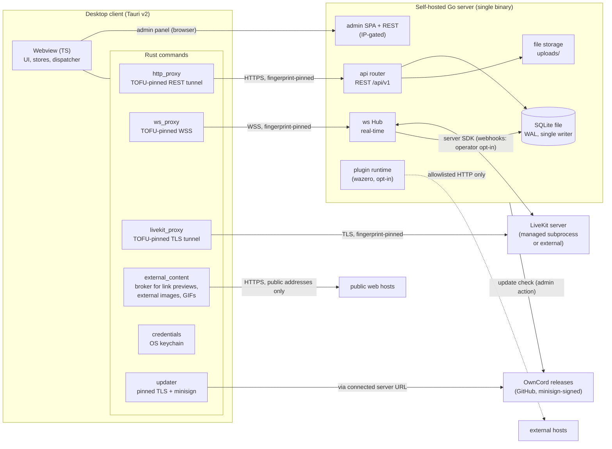
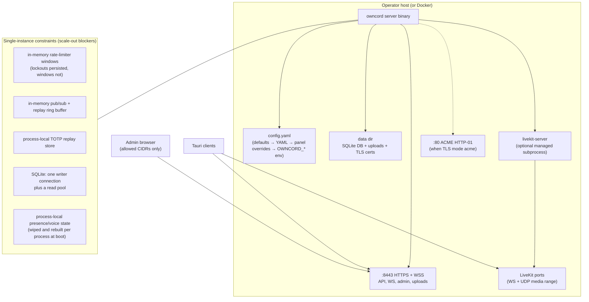

# System Overview

**Verified against:** `origin/dev` at `ac6ffc4e`, 2026-10-13

This page is the one-picture view of OwnCord. Read it first if you want to
know which processes exist, how they talk to each other, and where the trust
boundaries are.

OwnCord is a self-hosted chat stack with four parts:

- one Go server binary per community;
- a Tauri desktop client that can hold profiles for many servers, with one
  active connection at a time;
- LiveKit for voice and video media;
- a web admin panel built into the server.

## D1 — System context and trust boundaries

**What this shows.** Every connection from the client to its own server goes
through a Rust proxy that pins the server's certificate. There are three:

- `http_proxy` carries REST calls, uploads and file downloads;
- `ws_proxy` carries the app WebSocket;
- `livekit_proxy` carries LiveKit signalling.

All three pin a trust-on-first-use (TOFU) SHA-256 fingerprint per host. TOFU
means the app asks you to accept the certificate the first time, then refuses
any other certificate later. Content that other users link to, such as link
previews and external images, goes through a separate Rust broker. That broker
reaches only public addresses and never carries your session token. The
details are in [trust-model.md](../trust-model.md).

The admin panel is served by the same binary. It only answers addresses in
the configured CIDR list, which is private ranges by default. The plugin
endpoints also need an admin bearer token. Plugins run in a WASM sandbox, and
their HTTP access is limited to an allowlist. Both the server self-updater and
the client updater check minisign signatures against public keys built into
the binary.

## D8 — Deployment topology

**What this shows.** One process serves one community. That process owns TLS
(self-signed, your own certificate, or ACME), the database, uploads, the admin
panel and, optionally, LiveKit.

The design is single-instance on purpose. These things live only in the
process's memory:

- rate-limit windows;
- pub/sub and the replay ring buffer;
- the TOTP replay store;
- presence and voice state, which is rebuilt from live connections at every
  boot.

SQLite has a single writer connection. An OS-level lock file beside the
database stops a second server process from opening it, so a second process
fails at once instead of fighting the first. Running several server processes
for one community is out of scope today. The constraint boxes name what would
have to move to shared infrastructure if that ever changes.

Two more parts of the process lifecycle:

- A maintenance loop runs every 15 minutes (`Server/internal/app/maintenance.go`).
  Its steps include removing expired sessions and orphaned attachments,
  scheduled backups, message retention, finishing account erasures and
  reconciling stored files. After five failed passes in a row, a circuit
  breaker skips one tick and then tries again.
- On SIGINT or SIGTERM the server drains open work before it exits.

**Client platforms.** The desktop client ships for Windows and Linux (x86_64
and ARM64) only. macOS is left out on purpose. A trustworthy macOS build needs
Apple notarization, which means a paid developer account and CI signing
secrets. An unsigned build would teach users to bypass Gatekeeper. This will be
revisited if that commitment is made.

**Source of truth:** `Server/main.go`, `Server/config/config.go`,
`Server/docker-compose.yml`, `docs/deployment.md`, `docs/server-configuration.md`,
`Client/src-tauri/src/lib.rs`.
