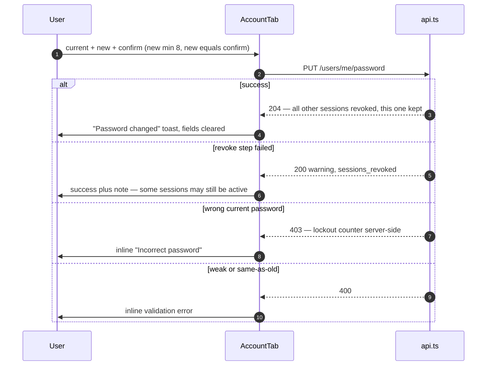
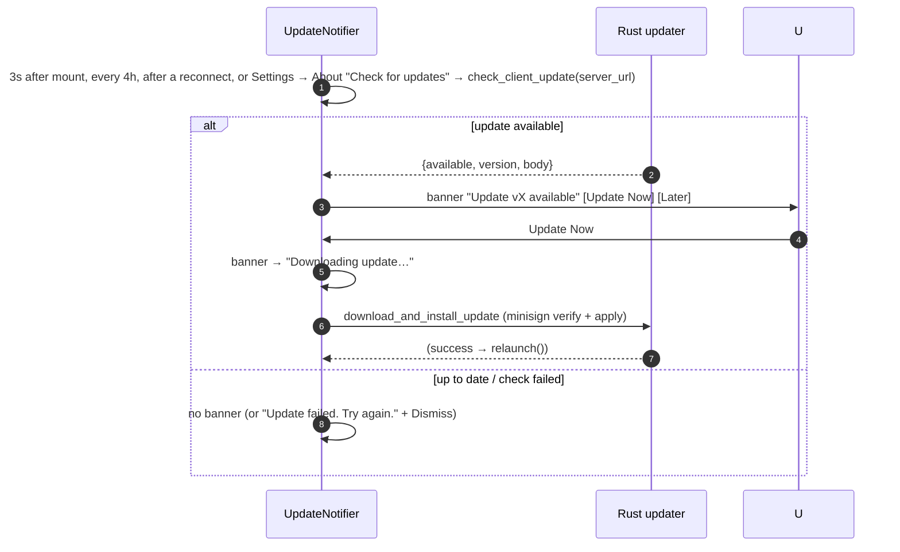

# Settings & Admin — target UX

**Verified against:** commit `5630aa1`, 2026-08-04
Part of the [Client UX Specification](README.md).

Covers: the settings overlay and its tabs, account operations (profile, password,
2FA, delete), appearance/theming, the client's **inline** admin surface (ban/kick/
roles, channel CRUD, invites), and the updater. It also marks the boundary
between what the desktop client does and what lives only on the server web panel.

---

## 1. Settings overlay

A tabbed overlay (`SettingsOverlay`) available both authenticated (in Main) and
unauthenticated (on Connect, for appearance/advanced). Tabs: Account,
Appearance, Accessibility, Voice & Video, Text & Images, Notifications, Keybinds,
Advanced, Diagnostics & logs, About (Discord's app-settings order, then the
OwnCord-only tabs). The app version sits under Log Out, and Log Out asks "Are
you sure you want to log out?" first. About shows the client version, the update
check, the release notes of this version and every earlier one (the
repository's `CHANGELOG.md`, built into a lazy chunk, never fetched) and a
GitHub link. The first start on a new version shows that version's notes once
in a "What's new" dialog (`features/whats-new/`); a fresh install does not.

The Safety tab (labelled "Privacy & Safety") lists, top to bottom: Direct messages (two
switches stored on the server: "Allow direct messages from server members" and
"Message requests", the second disabled while the first is off; shown only when
`ready.capabilities.dm_privacy`), Blocked users, moderation notices and
restrictions, appeals and My reports. A failed save puts the switch back and
shows an inline error.

**Target rules:**

- A failed save shows an inline error. A successful one is silent: Discord
  saves toggles and selects without a toast, so OwnCord does not confirm each
  one. Actions that do something beyond storing a value (copy, reset, revoke)
  still say what happened.
- Preference writes are immediate and local (localStorage `owncord:settings:*`),
  broadcast via the `owncord:pref-change` event so open views re-read live (e.g.
  theme, message density) without a restart.
- Structural/durable data (server profiles, window geometry, per-user volumes)
  persists through the Rust key-allowlisted store (`settings.json`); lightweight
  UI prefs through localStorage. This split is intentional; the spec preserves it.

---

## 2. Account operations

The Account tab holds the identity-sensitive flows. All require the current
password for sensitive changes and are rate-limited server-side.

### 2.1 Profile edit

| Step                 | Reaction                                                                                                                  |
| -------------------- | ------------------------------------------------------------------------------------------------------------------------- |
| Edit username/avatar | `PATCH /users/me`; optimistic `auth.updateUser`; server broadcasts `user_update` so the member list + own bar update live |
| Failure              | Inline field error + rollback                                                                                             |

### 2.2 Change password (with session revocation)

**Target rule (the W2-2 contract, surfaced to the user):** once the password is
committed, the operation is a **success** even if the session-revocation step
fails — the UI must never present a committed change as an error (that would walk
the user into the confirm-lockout). The partial-success `200 {warning}` maps to a
success message with a soft note, never a red error. (Server contract:
`handleUpdateProfile()` in `Server/api/profile_handler.go`; client already toasts success, the `onUpdateProfile` handler in `pages/MainPage.ts`.)

### 2.3 Two-factor (TOTP)

| Flow             | Steps                                                                                                                                                                                                                    |
| ---------------- | ------------------------------------------------------------------------------------------------------------------------------------------------------------------------------------------------------------------------ |
| Enable           | Password prompt → `POST /totp/enable` → render QR URI + backup codes → 6-digit confirm → `POST /totp/confirm` → "Enabled" badge, `auth` user `totp_enabled:true`                                                         |
| Disable          | Password confirm → `DELETE /totp`; a `403`/"required" is rewritten to "2FA is required by this server and cannot be disabled" (already the 403 rewrite in `buildTotpDisableView()`, `components/settings/AccountTab.ts`) |
| Regenerate codes | With 2FA enabled: password confirm → `POST /totp/recovery-codes` → the new set is shown once (copy + Done); the old set is invalid server-side and never kept client-side                                                |

**Target rule:** backup codes are shown exactly once, with an explicit "Save these
now — you won't see them again" and a copy affordance.

**Recovery kit (B7-15b).** A row beside 2FA in the Security card shows the kit status from
`GET /users/me/recovery-kit` — Enrolled, Used (spent by a recovery) or Not set
up — and "Create"/"Replace recovery kit" behind a password confirm →
`POST /users/me/recovery-kit`, which returns the server-generated secret once.

**Shown-once secrets** (backup codes, regenerated codes, the kit secret) share
one reveal (`buildShownOnce()` in `components/settings/RecoverySections.ts`):
never logged, never written to any storage, and wiped from the DOM on Done, on
a tab switch and on closing the overlay (closing aborts the tab's build
signal). While a kit or regenerated-codes request is in flight, close (Escape,
button, backdrop) and tab switches are ignored so the only copy is shown first
(`holdOpen()` in `components/SettingsOverlay.ts`). `tests/unit/recovery-secrets.test.ts` plants these values and proves
none reaches a log entry, the console or browser storage.

### 2.4 Sessions & delete account

| Action                   | Reaction                                                                                                                                                                                                                                                                                                                                                                                                                                                                                                                      |
| ------------------------ | ----------------------------------------------------------------------------------------------------------------------------------------------------------------------------------------------------------------------------------------------------------------------------------------------------------------------------------------------------------------------------------------------------------------------------------------------------------------------------------------------------------------------------- |
| List sessions            | `GET /users/me/sessions`; show device/IP/last-used; current session marked. Both desktop User-Agents read "OwnCord desktop"                                                                                                                                                                                                                                                                                                                                                                                                   |
| Revoke a session         | `DELETE /users/me/sessions/{id}`; optimistic removal + toast ("can no longer connect"); a refused revoke puts the row back. No per-row revoke on the current device. Its REST requests fail at once; when a device showing "Signed in elsewhere" revokes the device holding the live socket, the server closes that socket in the same request                                                                                                                                                                                |
| Sign out everywhere      | Inline confirm stating this device is included → `DELETE /users/me/sessions`; when `current_session_revoked`, `clearAuth()` → connect page                                                                                                                                                                                                                                                                                                                                                                                    |
| Sign-in not yet reviewed | On connect and on window focus the main page lists sessions, at most once per 30 s after a successful listing; a non-current row with `unseen` raises a toast naming its device, IP and time and pointing to Settings > Account. The listing is the acknowledgement — no WebSocket frame, no timer (`lib/session-notice.ts`)                                                                                                                                                                                                  |
| Signed in elsewhere      | The server sends `SESSION_REPLACED` first when this device's own session reconnects elsewhere (a reload) or the account is over its 10-connection cap; a different device no longer displaces this socket. An older server also refused a wake reconnect with `ANOTHER_DEVICE_ACTIVE` while another device held the session. Either way the client does not reconnect and keeps the credential; the connection banner shows "Signed in elsewhere" with "Use here", which reconnects without a wake marker (last connect wins) |
| Message retention        | Shown only when `server-info` reports a server-default window (`retentionNotice()` in `lib/types.ts`)                                                                                                                                                                                                                                                                                                                                                                                                                         |
| Delete account           | **Modal with password confirm** (irreversible — stronger than a two-click). The warning says erasure is immediate, earlier backups keep a copy until they rotate (a restore re-applies it), and other devices may keep cached images; no retention window. `DELETE /auth/account` → `clearAuth()` → the account's image-cache scope is pruned → connect page                                                                                                                                                                  |

---

## 3. Inline admin surface (client)

The desktop client exposes a **subset** of admin operations inline, gated by the
actor's role. Everything here must (a) only appear for users who can perform it,
and (b) confirm destructive actions.

| Operation        | Affordance                         | REST                                                           | Reaction                                                                                                      |
| ---------------- | ---------------------------------- | -------------------------------------------------------------- | ------------------------------------------------------------------------------------------------------------- |
| Change role      | Member context menu → submenu      | `PATCH /api/v1/moderation/members/{id}` `{role_id}`            | Toast; `member_update` reflects live                                                                          |
| Kick             | Member menu, two-click confirm     | `DELETE /api/v1/moderation/members/{id}/sessions`              | Toast "Kicked {user}"; sessions revoked, socket dropped at once → `presence` offline                          |
| Ban              | Member menu, two-click confirm     | `PATCH /api/v1/moderation/members/{id}` `{banned, ban_reason}` | Toast; `member_ban` removes them                                                                              |
| Create channel   | Sidebar → modal                    | `POST /api/v1/moderation/channels`                             | Modal closes on success; `channel_create`                                                                     |
| Edit channel     | Channel menu → modal               | `PATCH /api/v1/moderation/channels/{id}`                       | `channel_update`                                                                                              |
| Delete channel   | Channel menu, two-click confirm    | `DELETE /api/v1/moderation/channels/{id}`                      | `channel_delete`; redirect if active                                                                          |
| Reorder channels | Drag, or channel menu Move Up/Down | `PATCH …/{id}` `{position}` per moved                          | Optimistic; roll back on failure                                                                              |
| Invites          | Invite manager modal               | `GET/POST/DELETE /invites`                                     | Live codes only (expired/revoked hidden), masked, with creator; copy, revoke; empty state "No active invites" |

**Target rules:**

- **✓ Destructive admin actions show an in-flight state (2026-08).**
  `withConfirmation` (`AdminActions.ts`) keeps the item in a pending
  label/class while the promise settles and ignores further clicks, so a slow
  ban no longer looks ignored; unblock, ban submit, purge, and the role-change
  submenu carry their own equivalent guards (a role change in flight also
  inerts the other role options — `currentRole` only updates when the
  `member_update` echoes).
- **✓ Ban collects a reason (2026-07/08).** The ban flow renders an inline
  reason input plus a duration choice (`appendBanFlow()` in `components/AdminActions.ts`),
  and the menu passes both through
  (the `onBan` handler in `createSidebarMemberSection()`, `pages/main-page/SidebarMemberSection.ts` → `api.adminBanMember(userId, reason,
durationHours)`), so temporary bans and stored reasons work from the client.

### 3.1 What is _not_ in the client (by design)

The full admin panel — user list, audit log, server settings, channel
permissions, plugin management, backups, updates, first-run setup — is the
**server-rendered web panel** under `/admin`, gated by IP restriction + admin
auth. The Tauri client has **no** REST methods for these (confirmed: no plugin/
audit/settings/permissions/setup calls in `api.ts`). The one bridge the client
does have is a deep-link: `lib/admin-panel.ts` opens
`https://{host}/admin#{section}` in the OS browser (wired from
the Audit Log button handler in `createSidebarArea()`, `pages/main-page/SidebarArea.ts`, gated by
`lib/permissions.ts::canViewAuditLog`).

> **Decision point.** If the target is for admins to manage the server from the
> desktop app (audit log, settings, plugins) rather than the web panel, that is a
> **new surface** to build, not a gap in an existing flow. Flagged here so the
> boundary is explicit; the current split (inline moderation in the client, full
> administration on the web) may well be the intended design.

---

## 4. Appearance & theming

Themes are CSS custom properties (`styles/tokens.css`), 4 built-ins
(`dark | neon-glow | midnight | light`) plus custom overrides. **Target:** theme
changes apply **live** — `ui.setTheme` + the `owncord:pref-change` event re-skin
open views without reload. Appearance is editable pre-login (on the connect page)
so the app respects the user's theme before they authenticate.

**Custom themes** (Appearance > Custom Themes, `features/custom-themes/`): a saved
list of the user's own CSS, per device (`owncord:theme:custom:list` and
`owncord:theme:custom:active` in localStorage), at most one active, painted as
one `<style id="owncord-custom-theme">` after the built-in theme. Custom
properties are marked `!important` and a `:root`/`html` rule also targets
`body`, so a theme's tokens beat the built-in theme's inline and `body.theme-*`
ones. A theme may never load a file: after decoding CSS escapes, `url(`,
`image(`, `image-set(`, `cross-fade(`, `element(`, `src(`, `@import`,
`@font-face` and `@namespace` are refused on save, on import and again on every
paint; the CSP (`img-src`/`font-src 'self'`) stays behind it. Ctrl+Shift+Backspace
turns the active theme off (Backspace is not a bindable key, so no keybind can
claim it).

---

## 5. Updater

Self-hosted: the update endpoint derives from the connected server URL, over
TOFU-pinned (or system) TLS, minisign-verified inside the Tauri updater plugin.

| State       | Presentation                                                                                                                                                                                                                                                                                                                                                                                                                                                                                                                                                                                                                                                                                                                                                                                                                                                                                                                                    |
| ----------- | ----------------------------------------------------------------------------------------------------------------------------------------------------------------------------------------------------------------------------------------------------------------------------------------------------------------------------------------------------------------------------------------------------------------------------------------------------------------------------------------------------------------------------------------------------------------------------------------------------------------------------------------------------------------------------------------------------------------------------------------------------------------------------------------------------------------------------------------------------------------------------------------------------------------------------------------------- |
| checking    | Silent (no UI until a result)                                                                                                                                                                                                                                                                                                                                                                                                                                                                                                                                                                                                                                                                                                                                                                                                                                                                                                                   |
| available   | Non-modal banner with version + Update Now / Later (already `createUpdateNotifier()`/`showBanner()`, `components/UpdateNotifier.ts`); on Windows a line below says SmartScreen will warn about the unsigned installer (More info → Run anyway)                                                                                                                                                                                                                                                                                                                                                                                                                                                                                                                                                                                                                                                                                                  |
| downloading | Banner "Downloading update… N%" (or "… N.N MB" until Content-Length is known)                                                                                                                                                                                                                                                                                                                                                                                                                                                                                                                                                                                                                                                                                                                                                                                                                                                                   |
| applied     | App relaunches automatically                                                                                                                                                                                                                                                                                                                                                                                                                                                                                                                                                                                                                                                                                                                                                                                                                                                                                                                    |
| failed      | "Update failed. Please try again later." + Dismiss                                                                                                                                                                                                                                                                                                                                                                                                                                                                                                                                                                                                                                                                                                                                                                                                                                                                                              |
| no update   | Silent for background checks (startup, 4-hour interval, reconnect; at most one fresh check per 60 s, a check inside that gap is postponed to its end; scheduled retries are exempt). The reconnect check waits a random 0-60 s so clients behind one IP do not burst the endpoint rate limit, and a failed background check retries up to 3 times after 2-5 min. The Settings → About "Check for updates" row (`features/updates/UpdateCheckRow.ts`) instead reports up to date, available (with an install button) or couldn't check, and shows a dismissed version again. **Later** holds for that one version only. A `204` from `/client-update` ("already latest", or the server withholding a release **newer than itself**), an offered file built for another OS or processor, and a failed/offline check both render nothing in the banner — a connected client is compatible by definition, so silence is correct (B7-12, Decision 5) |

**Update required (B7-12).** When the server's `protocol_epoch` is **newer**
than this build's, the connect page raises the `IncompatibleNotice`
(`pages/connect-page/IncompatibleNotice.ts`) naming the client as the side to
update, with both epoch numbers, and offers "Update client" (mounting this same
`UpdateNotifier`) plus "Choose another server" to defer. The notice appears for
the selected/attempted host or a WebSocket `protocol_epoch_unsupported`
refusal — never from the background probe alone. When this client is the newer
side, the same notice names the **server** as the side to update and offers only
the leave exit, because installing this client cannot resolve that refusal.

> **✅ Wired — download progress.** The Rust download callback
> (`download_and_install_update` in `update_commands.rs`) accumulates received
> bytes and emits an `update-progress` event (`{ received, total }`) to the
> webview. `downloadAndInstallUpdate(serverUrl, onProgress)` (`updater.ts`) listens
> for it and forwards to `UpdateNotifier`, whose `formatDownloadProgress` renders a
> percentage when `total` is known and falls back to bytes (MB) otherwise, so the
> banner never looks hung. (Rust change is minimal and CI-gated only.)

---

## 6. System tray

The tray icon (`src-tauri/src/tray.rs`) is a parallel presence/window surface:
**Show/Hide** toggles the main window, a **Status** submenu
(Online / Idle / Do Not Disturb / Offline) emits a `status-change` event that
the TS side applies through the same presence path as the user-bar picker
(`lib/userStatus.ts` / `components/StatusPicker.ts`), **Mute / Unmute** and
**Deafen / Undeafen** emit the `voice-shortcut` event that the global
Ctrl+Shift+<key> poller (`src-tauri/src/shortcuts.rs`, rebindable from the
Keybinds tab) also emits,
toggling the same controls as the in-app shortcuts (a no-op outside a voice
channel), **Open Log Folder** opens the client log directory, and **Quit** exits
the app.

**Unread badge (DP-27).** The taskbar button and the tray tooltip carry the
unread count: mentions in server channels plus unread direct messages (a muted
conversation adds only its mentions; the `nothing` notification level shows
none). `src/features/unread-badge/unreadBadge.ts` counts from the stores and
calls the `set_unread_badge` command (`src-tauri/src/unread_badge.rs`) when
the count changes, and again when the window is shown or focused (Windows drops
the overlay when the taskbar button is recreated); a message that leaves the
count unchanged costs no IPC call. Windows draws a red overlay icon with the count, capped
at "9+"; Linux sends the Unity `LauncherEntry` D-Bus signal on the session
bus, which KDE Plasma and Ubuntu's dock read but **stock GNOME does not** (it
needs an extension such as Dash to Dock); macOS badges the dock icon. On
Windows and macOS the tray tooltip reads "OwnCord — N unread mentions"; Linux
tray icons (libappindicator) have no tooltip, so there the launcher count is
the only indicator. Both clear at 0 and on logout.

---

## Source of truth

`src/components/SettingsOverlay.ts` (+ `settings/*`), `src/components/AdminActions.ts`,
`src/components/InviteManager.ts`, `CreateChannelModal.ts`, `EditChannelModal.ts`,
`DeleteChannelModal.ts`, `src/components/UpdateNotifier.ts`, `src/lib/updater.ts`,
`src/lib/api.ts`, `src/lib/themes.ts`, `src/lib/preferences.ts`,
`src/pages/main-page/SidebarArea.ts`, `SidebarMemberSection.ts`,
`OverlayManagers.ts`, `src-tauri/src/commands.rs`, `src-tauri/src/update_commands.rs`;
server `Server/admin/api.go`, `Server/api/profile_handler.go`, `totp_handler.go`.
