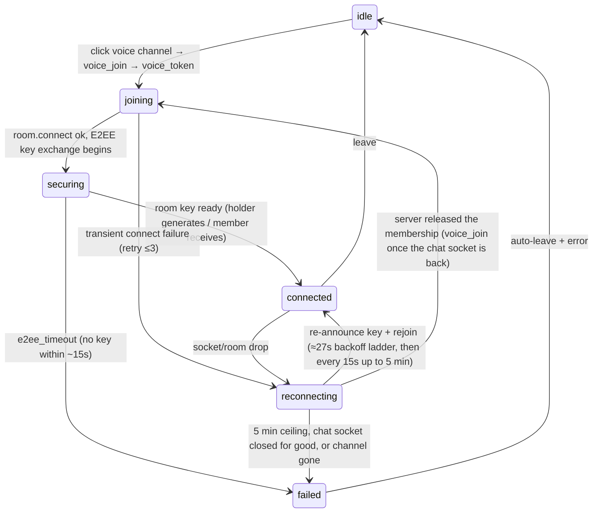

# Voice, Video & E2EE — target UX

**Verified against:** commit `5630aa1`, 2026-08-04 — except the mute/deafen
rows, re-measured at `a3a0a49b`, 2026-09-18.
Part of the [Client UX Specification](README.md). The signaling/crypto mechanics
are mapped structurally in [../voice-e2ee.md](../voice-e2ee.md); this document
specifies the **user-facing** states and reactions.

Covers: joining/leaving voice, mute/deafen/camera/screenshare, push-to-talk, the
active-speaker display, and — the main gap — the E2EE "securing / secured"
indicators.

---

## 1. Two state machines, one status

Internally there are **two** FSMs:

- The **WS connection** FSM (`ws.ts`: `disconnected…connected`) — the socket.
- The **voice session** FSM (`livekitSession.ts`, types in
  `features/voice/sessionState.ts`: `idle | connecting |
connected | reconnecting`) — the LiveKit room.

Plus the user-facing booleans in `voice.store` (`localMuted`, `localDeafened`,
`localCamera`, `localScreenshare`, `listenOnly`, `joinedAt`) and the per-user
roster (`voiceUsers` with per-user `speaking/muted/deafened/camera/screenshare`).

**Target:** expose the voice session as one observable `voiceStatus` the widgets
read — `idle | joining | securing | connected | reconnecting` — rather than
inferring it from `isVoiceConnected()` alone.

> **✓ Implemented (2026-07).** `voice.store.voiceStatus`
> (`idle | joining | securing | connected | reconnecting`) is now the observable
> voice-session status. The voice session (`livekitSession.ts` and its
> `features/voice/` modules) is the single writer: `joining` at the
> start of `connectAndSetup`, `securing` when the ECDH key exchange begins,
> `connected` on the atomic `connected` transition (both the initial join and a
> successful auto-reconnect), `reconnecting` when the room drops and the reconnect
> loop forms its state, and `idle` on `leaveVoice`. `joinVoiceChannel` seeds
> `joining` optimistically on click so the widget reacts before the `voice_token`
> round-trip. The VoiceWidget reads it to distinguish "connecting to the room"
> from "securing the encryption" from "reconnecting". `failed` is not a persisted
> status: an E2EE-timeout / connection error auto-leaves to `idle` and surfaces a
> toast via `onErrorCallback` (§2).

---

## 2. Join / leave

| Status         | Presentation                                                           | Notes                                                                                                                                                                                                                                                                                                                                                                                                                                                                                                                                                                                                                                                                                                                                                                                                                                                                                                                                                                                                                                                                                                                                                                                                                                                                                                                                                                                                                                                                                                                                                                            |
| -------------- | ---------------------------------------------------------------------- | -------------------------------------------------------------------------------------------------------------------------------------------------------------------------------------------------------------------------------------------------------------------------------------------------------------------------------------------------------------------------------------------------------------------------------------------------------------------------------------------------------------------------------------------------------------------------------------------------------------------------------------------------------------------------------------------------------------------------------------------------------------------------------------------------------------------------------------------------------------------------------------------------------------------------------------------------------------------------------------------------------------------------------------------------------------------------------------------------------------------------------------------------------------------------------------------------------------------------------------------------------------------------------------------------------------------------------------------------------------------------------------------------------------------------------------------------------------------------------------------------------------------------------------------------------------------------------- |
| `joining`      | Voice widget shows "Connecting…"; channel roster shows self pending    | `handleVoiceToken` → `connectAndSetup`                                                                                                                                                                                                                                                                                                                                                                                                                                                                                                                                                                                                                                                                                                                                                                                                                                                                                                                                                                                                                                                                                                                                                                                                                                                                                                                                                                                                                                                                                                                                           |
| `securing`     | "Securing connection…" indicator (lock, in-progress)                   | Non-key-holders block here until a room key arrives (10 s + 5 s retry, the "securing" key-exchange block in `connectAndSetup` (`features/voice/joinOrchestration.ts`) / `E2EEManager.setupKeyExchange` (`lib/voice/livekitE2EE.ts`))                                                                                                                                                                                                                                                                                                                                                                                                                                                                                                                                                                                                                                                                                                                                                                                                                                                                                                                                                                                                                                                                                                                                                                                                                                                                                                                                             |
| `connected`    | "Voice Connected" + elapsed timer (from `joinedAt`); "Secured" chip    | E2EE active; per-user tiles live                                                                                                                                                                                                                                                                                                                                                                                                                                                                                                                                                                                                                                                                                                                                                                                                                                                                                                                                                                                                                                                                                                                                                                                                                                                                                                                                                                                                                                                                                                                                                 |
| `reconnecting` | "Reconnecting voice…"; controls frozen, not torn down                  | Keypair regenerated for forward secrecy (`attemptAutoReconnect()` → `reannounceForReconnect()`, `lib/voice/livekitSession.ts`). RT-9: five attempts with a 3 s-doubling backoff capped at 6 s (about 27 s) so the loop outlasts a companion LiveKit restart instead of ejecting the call; P2-T5 (D-4): then one every 15 s while the chat socket is connected or reconnecting and the channel exists, until 5 minutes after the drop, refreshing a token over 4 minutes old first. Before each attempt the loop checks the channel still exists and the voice roster still lists us; while the chat socket is not connected the roster cannot say, so attempts wait for it. Once the server has released the membership (RT-8 grace expiry, an RT-3 reap, a restart), it sends `voice_join` for the same channel as soon as the chat socket is connected and hands over to the ordinary join path (`connectAndSetup`), so others see a leave and rejoin; a self `voice_leave` is left to the loop while it owns the session (not while livekit-client retries on its own inside a connected one). A refused rejoin — the server refuses an automatic one for 60 s after any moderator kick or move — ends the call with the voice-lost toast. Also shown while livekit-client retries on its own (`RoomEvent.SignalReconnecting`/`Reconnecting` until `Reconnected`, `lib/voice/roomEventHandlers.ts`); if neither `Reconnected` nor `Disconnected` arrives within 10 s of the first such event, the room is abandoned and the loop above takes over (`SIGNAL_RESUME_BUDGET_MS`) |
| `failed`       | Toast "Voice connection lost" / "Couldn't secure the call"; auto-leave | `onErrorCallback` fires                                                                                                                                                                                                                                                                                                                                                                                                                                                                                                                                                                                                                                                                                                                                                                                                                                                                                                                                                                                                                                                                                                                                                                                                                                                                                                                                                                                                                                                                                                                                                          |

**Target rules:**

- The "connecting" vs "securing" distinction is user-visible: while a non-key-holder
  waits for the room key, show **securing**, not a generic spinner — an E2EE call
  that's still exchanging keys is not yet private.
- Leaving is immediate and local (`leaveVoice`): tear down tracks, clear E2EE
  state, reset camera/screenshare, `idle`.

> **✓ Implemented (2026-07).** The VoiceWidget header now renders the E2EE phase
> from `voiceStatus`: a "Securing…" label (amber) while the key exchange runs and
> a persistent "Secured" chip (shield icon) once the room key is ready and the room is
> connected — replacing the log-line-only feedback. `joining` shows "Connecting…"
> and `reconnecting` shows "Reconnecting voice…", neither showing the secured
> badge. An E2EE-timeout still shows the "couldn't secure the voice call" message and auto-leaves
> (`features/voice/joinOrchestration.ts` `connectAndSetup`). **Code vs. diagram note:** the client
> actually runs the ECDH key exchange _before_ `room.connect()`, so `securing`
> spans the key wait and the media connect; the state diagram below draws them in
> the reverse order for readability. The distinction users see is unchanged:
> non-key-holders sit in `securing` until a room key arrives.

---

## 3. Local controls

All four are optimistic with rollback; each also emits a WS control message.

| Control         | Local state                                                                                                                                                                                                                                                                                                                           | WS message                    | Rollback                                     |
| --------------- | ------------------------------------------------------------------------------------------------------------------------------------------------------------------------------------------------------------------------------------------------------------------------------------------------------------------------------------- | ----------------------------- | -------------------------------------------- |
| **Mute**        | `localMuted` (`setLocalMuted`) — stops the mic capture track (`stopMicTrackOnMute` in the Room's `publishDefaults`, applied by `applyMicMuteState`, `features/voice/mediaControl.ts`), so the OS microphone in-use indicator goes out; the LiveKit publication is **not** removed — it stays muted, and unmute re-acquires the device | `voice_mute{muted}`           | n/a (local-authoritative)                    |
| **Deafen**      | `localDeafened` + forces mute — unsubscribes remote voice audio and mutes screen-share/stream audio (it stays subscribed; undeafen restores each stream's own per-tile mute)                                                                                                                                                          | `voice_deafen` + `voice_mute` | implies mute                                 |
| **Camera**      | `localCamera` set optimistically, rolled back on device failure (`enableCamera()` in `lib/voice/screenShare.ts`)                                                                                                                                                                                                                      | `voice_camera{enabled}`       | revert on failure + toast                    |
| **Screenshare** | `localScreenshare` optimistic, rollback on failure (`enableScreenshare()` in `lib/voice/screenShare.ts`); rate-limited                                                                                                                                                                                                                | `voice_screenshare{enabled}`  | revert + toast; a dismissed picker is silent |

Mute and deafen live in the user panel (`components/UserBar.ts`, next to
Settings), not the voice widget. They, their keys and the tray work outside a
call too: there they change only the local state and send nothing. The
member's own mute and deafen are saved (`saveSelfVoiceState`, never a
moderator's deafen) and loaded when the main page starts
(`restoreSavedSelfVoiceState`); the next join applies them and restates them
to the server. Deafen outside a call does not silence app sounds.

`stopMicTrackOnMute` carries the SDK's own documented tradeoff: with a Bluetooth
headset connected, stopping and re-acquiring the capture track makes the device
switch profiles (HFP to A2DP), which is audible in playback. Muting has to stop
the OS capture rather than only mute the publication, so the profile switch is
the accepted cost.

| Control state  | Presentation                                                                                                                                                                                                                                                                           |
| -------------- | -------------------------------------------------------------------------------------------------------------------------------------------------------------------------------------------------------------------------------------------------------------------------------------- |
| mic muted      | Mic-slash icon on self tile + control bar                                                                                                                                                                                                                                              |
| deafened       | Headphone-slash alone (deafen implies mute, so no mic-slash beside it); a moderator mute or deafen gives it the server-muted class and title                                                                                                                                           |
| server muted   | Distinct server-muted icon (title "Muted by a moderator"); the user panel's mute/deafen buttons are disabled with the reason while the mute holds — `serverMuted`/`serverDeafened`, `components/ChannelSidebar.ts`, `components/UserBar.ts`                                            |
| listen-only    | Badge "Listen only — no microphone" with a **Retry mic** affordance (`retryMicPermission`); the mic button is disabled, dimmed and reads mic-off                                                                                                                                       |
| camera on      | Self video tile in the grid                                                                                                                                                                                                                                                            |
| screenshare on | Screen tile; a stop-share affordance always visible                                                                                                                                                                                                                                    |
| speaking       | Green ring on the speaking user's tile/avatar, and on your own user-panel avatar (your own: the input-sensitivity gate when one runs; others: LiveKit ActiveSpeakers, held 200 ms after they drop out; a mute or disconnect clears it at once, and leaving a channel clears its rings) |

**Video tiles** (`components/VideoGrid.ts`, in guild voice and DM calls alike):
each tile is a button (click, Enter, Space) that opens it in focus view, with a
filmstrip for the rest and **Back to grid** to leave. Screen shares carry a
**LIVE** badge, and the speaking ring (`--text-positive`) and a mic-slash or
headphone-slash badge for a muted or deafened user are on camera tiles. A
**Show chat** control in the grid's header leaves the grid or focus view for
the chat without leaving the call. In the guild call view the header also has
**Show non-video participants**, **Show my camera** (hides only your own
camera tile, here) and, in focus view, **Show participant strip**; each is a
saved preference (`callShowNonVideo`, `callShowSelfCamera`, `callShowStrip`)
and none applies while the DM call panel hosts the grid. A control bar at the
bottom of the call view, in grid and focus view, has mute, deafen, camera,
share and disconnect; camera and share are inert until the join has connected.
On a phone with a front and a back camera, **Flip camera** sits beside Camera
while the camera is on and moves it to the camera facing the other way; a tap
while a flip is still switching does nothing. Share is left out where the
device cannot capture its screen (the Android app, a phone browser): those can
still watch a share.
**Pop out call**, last in the header, moves the whole call view (tiles,
toggles and control bar) into a pop-out window of its own and returns the app
window to the chat; opening the call again from the app raises that window.
**Bring the call back**, or closing the window, puts the call view back in the
app window; leaving the call closes it. Show chat and the camera picker arrow
are hidden there and the tile menu has no Profile row (each opens in the app
window), and starting a share brings the call back first so its picker is in
view.

**The voice channel's chat beside the grid** (guild calls): opening the call
view selects the voice channel you are in (`pages/main-page/callChat.ts`), so
its chat mounts as for any channel, and the grid sits left of it with the chat
in a column on the right (stacked under the grid at narrow width). The chat
column is 360px by default; the handle on its left edge resizes it (drag, or
the arrow keys, Home and End) from 280px to 640px, always leaving the grid
360px, and the width is saved (`features/voice/callChatResize.ts`, on the
shared `features/panes/paneResize.ts` handle). While the call view is up (and
in a forum channel) the member column steps aside so the grid gets its width; the
Member List toggle opens it for the moment without changing the saved choice,
and leaving the call view puts that choice back (`MemberColumn.setCallView`). The
split holds only while the active channel is the joined voice channel; a
stream watched over a text channel, a DM call and a popped-out call keep the
grid over the chat. Moving to another voice channel follows to its chat. Leaving
the call closes the grid and the chat stays, full width. Show chat lands on the
voice channel's own chat; click another channel to leave it. A voice channel is
not remembered as the last channel.
A remote tile's volume slider is named for whose it is ("Otto stream volume"
for screen-share audio, 0–100 %; "Otto voice volume" for the mic, 0–200 %; its mute
button is the same local Mute as the sidebar menu's) and
shows its value. The tile menu (right-click, the Menu key, Shift+F10;
`components/video-grid/tileMenu.ts`, loaded on first use) is the person's
menu: Profile, Message, the two volumes kept apart, Mute stream, the local
Mute, Focus (Back to grid when focused), Full screen, Pop out, **Stop
watching**, and the voice roster's moderation section where the channel's
`can_moderate_voice` allows it (none in a DM call). Profile and Message leave
full screen first. Your own camera tile's menu has Hide my camera (the call
view's Show my camera toggle) and Turn off camera; your own screen share has
no menu. Cameras play on
their own (**Automatically play cameras** in Voice & Audio settings, the
`autoPlayCameras` preference, default on): a remote camera is subscribed as it
is published. A screen share is opt-in, Discord-style: it arrives as a tile
behind a **Watch stream** card, and nothing of it (screen-share audio included)
is subscribed until the viewer clicks Watch stream, its voice-roster row or Pop
out; with the setting off, a camera is opt-in the same way. Stop watching
unsubscribes either and returns the card; a stopped camera stays stopped,
across its owner turning it off and on and across a channel switch, until you
leave voice, and a stream that ends is forgotten rather than stopped. A
screen share you were watching that ends says "Otto ended the stream" in its
tile for 3 s before the tile goes; the tile's controls are dead meanwhile, and
leaving voice or the same person sharing again replaces it at once. The watch
lasts as long as that cover: the same person sharing again within it is still
watched, and keeps the focus. A watch
survives a channel switch and the app's own reconnect or rejoin, but not
livekit-client's full reconnect, and ends when you leave voice. The setting is
read as each camera is published (and on a reconnect's sweep), so turning it
off leaves cameras already playing alone. The room connects with
`autoSubscribe: false`: `handleTrackPublished` (`lib/voice/roomEventHandlers.ts`)
subscribes each voice unless deafened, and each stream as
`RemoteTracks.isWatched` (`features/voice/remoteTracks.ts`) decides. On Linux
the native backend still auto-subscribes, so it unsubscribes an unwatched
stream as it is published. Every subscribed tile asks only for its displayed
size, and a tile nobody can see (grid closed, app hidden, stopped) for none.
Your own screen share is covered by what is going out (surface, resolution, fps, audio) with **Stop sharing** and
**Hide preview**. While you share, the voice widget shows a stream card
(`components/voice-widget/streamCard.ts`, loaded on the first share): what is
going out, **Change source**, **Quality** and **Stop sharing**. Change source
opens the picker and swaps the new capture under the published track
(`features/voice/screenshareChange.ts`), so viewers keep watching and the
server hears no `voice_screenshare`; cancelling the picker changes nothing.
Quality re-sizes the running capture for this share only (the Settings default
stays). On Linux the native capture picks in its own dialog, so the card has
Stop sharing only. In a DM call, focus view stays inside the call panel and the
chat remains visible below it. **Full screen** (the button, F, or a
double-click) puts the tile in HTML full screen and the window with it
(`desktop.window.setFullscreen`, `core:window:allow-set-fullscreen`), since in
WebView2 HTML full screen fills only the webview; if the API is refused, a CSS
theatre view fills the window instead (Escape or F leaves it). A full-screen tile keeps the same call controls at hand. **Pop out**
moves the tile's own video into a desktop window of its own (Discord-style; `window.open`
accepted by `src-tauri/src/popout.rs`, which builds it in the main webview's process, so no
second subscription), which can be maximised or go full screen from its own control, F or a
double-click. No capability names the pop-out label on purpose (capabilities only grant IPC;
the pop-out has none, and the main window drives its full screen by label), and the about:blank
popup inherits the app's CSP. The stream's volume and mute go along into the window, shown over the video.
The tile shows **Bring back**, and closing the window returns the video and its controls; closing the main window closes every pop-out. Where
no window opens the video stays in the grid and an error toast says "Couldn't open the pop-out window". Full screen on a
popped-out tile closes the pop-out first, and leaving full screen returns it to the grid (Pop out re-pops it).
**Ctrl + scroll** over a tile or a pop-out window zooms the video towards the pointer (up to 8x), and a
drag pans it, edges never pulled into view; a pan is no click, so it never focuses or swaps the tile, and
a plain scroll still scrolls the grid (`bindVideoZoom` in `src/lib/ui/zoomPan.ts`, shared with the image
lightbox). Scrolling back to 1x, a new or stopped stream, and popping out start it unzoomed; the
mini-player and your own screen share's cover do not zoom.
Choosing a text channel from the stream view, the open one included (`onChannelReselect` in
`lib/nav/channelNavigation.ts`), leaves it with voice still up, and the stream you watch keeps playing in
a **mini-player** over the app (`features/voice/miniPlayer.ts`, loaded on first use; the tile's own video
moves in, as with Pop out). It shows the streamer's name, drags (or moves with the arrow keys) anywhere
inside the window and keeps that spot for the session; **Return to stream** (or a double-click or
Enter) reopens the stream view, Pop out moves it to its window, Stop watching ends the watch, and it
closes when the stream ends. The grid's own **Show chat** control still closes the stream view
without a mini-player, so the stream stops receiving video as before. The
screen share you watch shows a quality chip ("1080p · 30 fps") with a stats popover
(resolution, frame rate, bitrate, codec, packet loss), polled every 2 s from
the receiver (`getRemoteVideoStats`); the Linux native room has no receiver
stats, so it shows the resolution only. A camera tile has no chip. In the grid a
camera fills its tile, cropped at the edges; focused or full screen it shows the
whole frame, and a screen share always does.
Each remote tile asks only for what it shows (`setRemoteVideoView`, since
`adaptiveStream` stays off for OC-0455): a tile no one can see (grid closed,
app hidden or minimised, Stop watching) receives no video, a small tile gets
the lower simulcast layer that fits it, the mini-player gets the layer for its
size, and the stream you watch (focused, full screen or popped out) gets the top one.

**Mic-permission failure** (`restoreLocalVoiceState`): on denied/absent mic, set
`listenOnly` and surface the specific reason ("Microphone permission denied" /
"No microphone found") as a toast with a retry — already wired to
`onErrorCallback` (the mic-unavailable branches of `restoreLocalVoiceState()`, `lib/voice/livekitSession.ts`); the spec makes the **Retry mic**
control a permanent part of the listen-only badge.

---

## 4. Push-to-talk

PTT is a Rust key-poller (`ptt.rs`, 20 ms) emitting `ptt-state{pressed}` →
`setPttGated(!pressed)` only while in a channel (the `ptt-state` listener inside
`initPtt()`, `platform/desktop/pushToTalkService.ts`): the key opens and closes
a gate inside the microphone processor (§8), never the mute, so the capture
stays open across presses and no press publishes a raw track. A release closes
the gate only after the saved release delay (`pttReleaseDelayMs`, 0–2000 ms,
20 ms by default); a press inside it cancels the close. The Linux native room
has no web microphone to gate: there the same `setPttGated` flips the Rust
session's own gate (`NativeRoom.setPttGated` → `nativeVoice.setPttGated`),
which zeroes the open capture's processed frames, so the capture also stays
open across presses; every enable sends the gate before the capture opens.
Only a mute or deafen closes the capture, on both paths.

The saved Input Mode (`inputMode`, `lib/ui/inputMode.ts`) decides whether a bound
key gates at all. In Voice Activity mode the poller never starts and a bound key
is only kept for later. In Push to Talk mode the poller arms the key, and the
input-sensitivity gate steps aside only while the poller is live with a key
bound (`effectiveVoiceSensitivity`); with no key, or on a host that cannot read
key state, the saved sensitivity keeps gating. A profile saved before Input Mode
existed starts in Push to Talk when it has a key bound (`migrateInputMode` in
`main.ts`). **Target UX:**

| State               | Presentation                                                                                                                                                                                                                             |
| ------------------- | ---------------------------------------------------------------------------------------------------------------------------------------------------------------------------------------------------------------------------------------- |
| input mode          | Voice & Audio opens with an "Input Mode" choice: Voice Activity (shows Input Sensitivity) or Push to Talk (shows the key and release delay, hides Input Sensitivity); the Keybinds tab notes the key does nothing in Voice Activity mode |
| PTT bound, released | Gate closed (nothing is heard), the mic button reads unmuted (it shows only your own mute) with the title "Push-to-talk — hold your key to talk"; toggling mute or deafen with the key up never opens the gate                           |
| PTT pressed         | Unmuted + speaking ring                                                                                                                                                                                                                  |
| release delay       | Voice & Audio (Push to Talk) and Keybinds tab: a "Push to Talk release delay" slider, 0–2000 ms in 10 ms steps, read on each release                                                                                                     |
| binding a key       | Keybinds tab: "Press a key…" (10 s capture window, `ptt_listen_for_key`); reject text keys with "Pick a non-text key"                                                                                                                    |
| PTT thread error    | Toast "Push-to-talk stopped unexpectedly" on `ptt-error`, offer re-enable                                                                                                                                                                |
| PTT unsupported     | macOS or a Wayland session (`ptt_polling_supported` false): the Keybinds tab says the key can never gate the mic and disables capturing a key (Clear stays, to remove an older binding)                                                  |

---

## 5. Voice roster (per channel)

The channel's voice roster renders from `voiceUsers`. Each participant tile
reflects their `speaking/muted/deafened/camera/screenshare`. **Target:**

| Signal            | Tile reaction                                                                                                                       |
| ----------------- | ----------------------------------------------------------------------------------------------------------------------------------- |
| `voice_state`     | Add/update the participant with their flags                                                                                         |
| `voice_leave`     | Remove the tile; if it's us (kick/disconnect), clear local voice state (already `handleVoiceLeave`, `features/voice/wsHandlers.ts`) |
| key-holder change | Invisible to users (re-election is automatic on leave); no UI churn                                                                 |

Per-user volume is adjustable (0–200%; saved values above 200% are read as 200%) and persisted (`userVolume_{id}:{host}`). Above 100% a voice track plays through its own gain node (`lib/voice/audioElements.ts`), since an audio element's volume stops at 1; with no running audio context it plays on the element at up to 100%. A local **Mute** per user (`userLocalMute_{id}:{host}`) silences them for this client and leaves the volume as it was; the sidebar row shows a speaker-off icon.

---

## 6. Token refresh & reconnect (invisible)

Token refresh (a 4 min timer against the 5 min token) and voice reconnect (five attempts, 3 s-doubling
backoff capped at 6 s, about 27 s, then every 15 s for up to 5 minutes) should be **invisible on success** beyond the
"Reconnecting voice…" badge while a reconnect runs. Only giving up surfaces:
"Voice connection lost — failed to reconnect" + auto-leave. A reconnect drops your camera and screen
share (`teardownForReconnect`); once it (or its rejoin) lands, the camera turns back on by itself, under
the server's video limit. A screen share needs the OS picker again, so a sticky toast says it stopped,
with a "Share again" button; on Linux X11 the same source is shared again with no dialog while the host
still lists it. Leaving voice removes the toast. The 60 s token-refresh response guard and the
forward-secrecy keypair rotation on reconnect are mechanics the user never sees.

**A planned restart returns the call (RT-12).** The hub wipes `voice_states` on
boot, so a client resumes chat but not voice. `handleRestartDrop`
(`features/connection/wsHandlers.ts`) records the channel the user is in when
the socket drops, and `ready` then sends one ordinary `voice_join` if that
channel is still a joinable voice channel or DM call. An `update`,
`backup_restore` or `setup` notice allows it when `ready` arrives within ten
minutes; a `shutdown` from outside the server (SIGTERM, a supervisor) allows it
only within a shorter two-minute window, so a quick restart returns the call
while a long maintenance stop ends it. A kick, move, ban or leave cancels the
pending rejoin, so the user is never put back into a call that was deliberately
ended.

---

## 7. E2EE identity verification surface

Peer identity state lives in `voice.store` (per-participant
`status: verified | changed | unverified | mismatch | unknown` + `safetyNumber`), written by
`features/voice/e2eePeerState.ts` (driven by `lib/voice/livekitE2EE.ts`) as
announces are verified against the pinned identity keys (`lib/net/identity.ts`).

| State        | Roster / DM tile badge (`verifyPresentation()`, `features/voice/peerVerification.ts`)                                          | Interaction                               |
| ------------ | ------------------------------------------------------------------------------------------------------------------------------ | ----------------------------------------- |
| `verified`   | Green shield; title "Same key as before · Safety number: {n} · Compare it with them to confirm it is them"                     | none needed                               |
| `changed`    | Amber shield-alert; title "Security key changed · Safety number: {n}"                                                          | none — the change already raised a notice |
| `unverified` | Neutral shield; no pinned key yet                                                                                              | none — pins on first verified announce    |
| `mismatch`   | Red shield-alert; title "Blocked — unverified: this participant's key is missing or its signature is invalid. Click to review" | Click → blocking identity-mismatch modal  |

A pinned peer whose published key changed is accepted automatically when the
announce verifies against the new key (`verifyPeerAnnounce` in
`features/voice/e2eePeerState.ts`): the pin is replaced, the change is logged
at warn, and a warning toast naming the peer stays until dismissed
(`showToast(…, "warning", Infinity)`). The peer keeps the `changed` badge
for the rest of the call. `mismatch` is now only a pinned peer whose key is no
longer delivered, or an announce that fails verification.

The mismatch modal (`createIdentityMismatchModal()`, `components/IdentityMismatchModal.ts`;
opened from `openIdentityMismatchModal()` in `features/voice/peerVerification.ts`, shared with `DmCallPanel`) shows the **new key's fingerprint** so
the user can verify it out-of-band before trusting. "Trust New Key" re-pins
via `rePinPeerIdentity` — deliberately pinning the exact key whose fingerprint
was displayed, not a fresh store read, so a malicious server cannot swap the
key during the human verification window (TOCTOU). Reject leaves the peer
blocked for E2EE media. A stripped or malformed published key disables the
trust action entirely (a blind accept is refused).

## 8. Media processing & devices

- **The microphone processor:** the whole outbound chain — RNNoise when
  Enhanced Noise Suppression is on, input gain, a 50 ms lookahead delay, the
  voice-activity gate and the push-to-talk gate — is one livekit-client
  `TrackProcessor` (`lib/voice/micProcessor.ts`) in its own 48 kHz AudioContext,
  attached to the microphone track when the room creates it, before the
  first publish (`RoomLifecycle.attachMicProcessorOnCreate`). livekit-client
  publishes, republishes and restarts a track through
  `track.mediaStreamTrack`, which is the processor's output while one is
  attached, so a device change, hot-plug, processing toggle, device-ended
  restart or full-reconnect republish never puts the raw capture on the
  sender. `lib/voice/audioPipeline.ts` owns the processor, holds the settings and
  runs the detector; a processor that cannot attach fails the publish.
- **Noise suppression:** RNNoise WASM worklet node (`lib/voice/noiseSuppression.ts`,
  assets `public/rnnoise.wasm` + `public/rnnoise-worklet.js`) inside the
  processor, toggled live in Settings → Voice & Audio without restarting the
  capture. The WASM is the current RNNoise model, the one
  `@jitsi/rnnoise-wasm`'s sync build embeds
  (`tests/unit/rnnoise-click-suppression.test.ts` pins it). If the worklet
  cannot start, the processor runs without it.
- **Video codec:** one setting in Settings → Voice & Audio (`videoCodec`,
  `features/voice/videoCodec.ts`) covers camera and screen share: VP8
  (default), H.264 or Auto. E2EE is always on, so livekit-client publishes no
  backup codec and every viewer must decode the chosen one. Auto picks H.264
  only when `MediaCapabilities.encodingInfo` reports it supported and
  power-efficient at that publish's size, frame rate and bitrate and WebGL's
  unmasked renderer names a non-Intel GPU, else VP8: livekit-client 2.22.3
  cannot decrypt Intel Quick Sync H.264 (livekit/client-sdk-js#2140), so a
  manual H.264 choice carries a warning. The Linux native engine always
  publishes VP8 and the setting is hidden there. In the Windows app on a
  non-Intel hardware GPU an H.264 camera or share offers only H.264 Main and High
  (`lib/voice/h264Profile.ts`, codec preferences set on every offer): WebView2
  encodes those on the GPU but Constrained Baseline only in software, and
  LiveKit answers Constrained Baseline first when it is offered. A saved
  H.264 there skips the `encodingInfo` probe, which always reports software
  in WebView2. The 120 fps share option is hidden for now
  (`lib/voice/shareFps.ts`): WebView2's capture delivers about 60 fps, and a saved
  120 reads as 60.
- **Sensitivity gate:** `public/vad-worklet.js` on the processor's tap
  (`startVadDetector`, with a setTimeout fallback of the same timing). It
  opens after about 32 ms of sustained level, so a mouse click does not open
  it, and closes after about 320 ms below the threshold; the lookahead delay means
  the start of a word is not cut off. Both read one level, a running RMS over
  four 128-sample blocks (about 10 ms), taken after the Input Volume gain, so
  turning a quiet microphone up lifts it over the gate. The settings meter runs
  the same processor over a microphone opened with the call's capture settings
  and the same detector at the same threshold: the bar is the loudest smoothed
  level it saw, on the threshold handle's axis.
- **Automatic input sensitivity:** on by default (`autoInputSensitivity`,
  `lib/ui/inputMode.ts`); a profile whose slider was moved off 50 keeps manual
  mode (`migrateAutoInputSensitivity` in `main.ts`). The detector then runs the
  threshold 10 dB above the room's noise floor, the quietest level of the last
  8 s (`lib/voice/noiseFloor.ts`), clamped between -60 dBFS and the default
  threshold, and moves it on the worklet without reopening the gate. Digital
  silence (a mute) never becomes the floor, and an Input Volume change
  relearns it. Settings hides the threshold handle and keeps the meter. The
  Linux native engine gates on the manual slider and shows no switch.
- **Push-to-talk:** the key only opens and closes the processor's second gate
  (`livekitSession.setPttGated`; `pushToTalkService.ts`). The microphone
  stays published and its capture stays open across presses, the store's
  `pttGated` never writes `localMuted`, and a user's own mute or deafen still
  stops the capture as before. On Linux the native room keeps its own gate
  behind the same call: the key flips the Rust capture's gate, which zeroes
  the open capture's processed frames, so there too the capture stays open
  across presses (§4).
- **Device hot-swap:** `lib/voice/deviceManager.ts` follows OS device
  plug/unplug and re-routes the active input/output without rejoining. An
  unplugged saved device falls back to the system default but stays the
  saved pick, and the call switches back to it once it is listed again.
- **No stream preview:** the voice channel sidebar shows camera/screenshare
  indicators only; hovering a user opens no live preview. There
  is no pre-share preview of your own stream in the app on Windows — that step
  is the OS `getDisplayMedia` picker dialog; on Linux it is the "Share your
  screen" dialog (`components/ScreenSharePicker.ts`).

## 9. DM calls (ring)

DM voice is the same voice machinery on the DM's voice channel, plus a ring
layer (no server-side call state — presence in the DM voice channel _is_ the
call):

| Event                      | Reaction                                                                                                                                                                                                                                                                                                                                                                                                                                                                                                                                                                                                                                                                                                                                                                                                                                                                                                                                                                                                                                                                                                                                                                                                                                                             |
| -------------------------- | -------------------------------------------------------------------------------------------------------------------------------------------------------------------------------------------------------------------------------------------------------------------------------------------------------------------------------------------------------------------------------------------------------------------------------------------------------------------------------------------------------------------------------------------------------------------------------------------------------------------------------------------------------------------------------------------------------------------------------------------------------------------------------------------------------------------------------------------------------------------------------------------------------------------------------------------------------------------------------------------------------------------------------------------------------------------------------------------------------------------------------------------------------------------------------------------------------------------------------------------------------------------- |
| Outgoing: user clicks Call | Caller joins the DM voice channel, then `call_ring` is sent once the voice session is connected (not while joining or securing) and held back (with transport slack) so it stays inside the 1/3 s server limit, and dropped if the socket disconnects meanwhile; a refused join sends none, and a 1:1 ring to someone who has not accepted the caller is refused at once with `CALL_REQUIRES_ACCEPTANCE` (the ring is never delivered; the caller's "Calling…" ends and the error toast explains), and a held-back ring or Ring again is dropped if the caller has left the call; the call panel shows "Calling…" and a 30 s no-answer window over the members who are online (offline members are left out, since the server drops their rings; if none is online all are kept) (`createOutgoingCall`, `lib/voice/callRing.ts`), except on a redial into a call someone else is already in, which only re-rings. While the ring is in flight the caller hears a soft 440 Hz ringback every 3 s (`lib/media/notificationSound.ts`); DND and the Incoming Call Sound toggle silence it, an incoming ring pauses it and it resumes when that ring ends, and it stops the moment the phase leaves `ringing` — a join, the last callee declining, the timeout or leaving |
| Incoming: `call_incoming`  | A repeating ringtone distinct from the message chime (`lib/media/notificationSound.ts`; governed by the Incoming Call Sound toggle and DND, which also silence the caller's ringback) driven by the `lib/voice/callRing.ts` state machine (30 s auto-timeout). When the window is not focused, a new ring also raises one "_X_ is calling you" OS notification (not under DND) and one urgent taskbar flash until focus (`features/direct-messages/callAlerts.ts`); clicking it opens the DM (`owncord://channel/<id>?host=` on Windows, same cross-server guard as a message notification). With the ringing DM open, the call panel is the answer surface and the banner stays hidden; anywhere else, `components/IncomingCallBanner.ts`                                                                                                                                                                                                                                                                                                                                                                                                                                                                                                                           |
| Accept                     | Join the DM voice channel; ring clears. "Join with video" also turns the camera on once connected. Being in the room answers the ring however you got there: joining it another way clears the ring, and a `call_incoming` for the channel you are already in is ignored                                                                                                                                                                                                                                                                                                                                                                                                                                                                                                                                                                                                                                                                                                                                                                                                                                                                                                                                                                                             |
| Decline                    | `call_decline` sent → the ringer's panel says "declined" in a 1:1, and in a group that callee drops off the ringing list. Another callee's ring stops when its own ringer declines (`call_declined`) or when a `voice_leave` for that channel leaves the room empty, whoever left; the ringer leaving while others stay in does not stop it. A caller who is not looking at that DM (another channel, settings or another view) gets one toast instead: "<name> declined"                                                                                                                                                                                                                                                                                                                                                                                                                                                                                                                                                                                                                                                                                                                                                                                            |
| Timeout / caller leaves    | Timeout: the callee's ring clears with a "Missed call from _X_" toast (plus an OS notification when the window is not focused; the ringer hanging up before the timeout is reported the same way, but an accept, decline or newer call is not a miss), and the caller's panel says "didn't answer", draws only the caller's own tile, and stays in the call with Ring again / Leave call; a caller who is not looking at the DM gets a "No answer" toast. Caller leaves: the call simply ends, the caller's outgoing ring clears, and the callees' rings clear once the room is empty, with the same "Missed call" notice. In a 1:1, when the other person hangs up and you are left alone, the connected panel's status reads "<name> left the call" with Ring again                                                                                                                                                                                                                                                                                                                                                                                                                                                                                                |

Call is on the DM chat header and in another member's profile popup. The
popup's Call opens the 1:1 DM with that member (creating it if needed) and then
starts the call there through the same `startCall` (`onCallUser` in
`pages/main-page/SidebarArea.ts`).

The DM call panel (`components/DmCallPanel.ts`, between the chat header and the
messages) shows while the open DM has a ring in flight, an outgoing ring, or
anyone in its voice channel: outgoing, declined/no answer, incoming, a "Join
call" strip for a call you are not in, and the connected stage (collapsible to
one row). Its controls are the voice widget's callbacks; the widget's call name
links back to the DM, and the DM list shows a phone glyph on a DM with a live call.

While the open DM is the current call's DM, the panel is the call's only video
surface: `VideoModeController` moves the shared `VideoGrid` into the panel's
stage as soon as any camera or screen share is on (remote ones too, unlike a
guild channel, where no video opens the grid on its own: turning on your camera
or share while reading a text channel keeps the chat, and the call view shows
it once opened; in the DM panel your own also while the call is still ringing
or went unanswered), the chat stays visible below, and
everyone without a camera is an avatar tile. Collapsed, the panel never reopens
on its own; Expand shows the video. Anywhere else the grid behaves as in guild
voice.

Camera and screen share are disabled in the panel and the voice widget until the voice status is `connected` (not while joining or securing).

`call_incoming` / `call_declined` are page-scoped listeners in `MainPage.ts`,
not dispatcher handlers (see [README §4](README.md)).

---

## 10. App sounds (DP-40)

The message chime, the DM ringtone, the caller's ringback and the voice UI
sounds share one `AudioContext` (`lib/media/notificationSound.ts`), whose output
follows the `audioOutputDevice` chosen in Settings › Voice & Audio through
`setSinkId`.
Where the webview cannot route an `AudioContext` (WebKitGTK, the Linux webview),
those sounds fall back to the system default — see
[known limitations](../../known-limitations.md#client).

`features/voice/uiSounds.ts` plays a short **voice UI sound** on your join,
leave and move; on another member joining or leaving the channel you are in;
on a screen share starting or ending in that channel, your own included (keyed
off the server's roster, so a cancelled picker plays nothing); and on your
mute/unmute and deafen/undeafen. One **Voice Sounds** toggle (Settings ›
Notifications, on by default) gates them, and DND silences them like the message
chime. Two edges stay silent by design: push-to-talk, and the wholesale roster
replacement (`setVoiceStates`) behind the initial `ready` and a reconnect
resync — the module keys remote joins off a monotonic roster revision that only
the incremental `voice_state`/`voice_leave` handlers bump, so a replay cannot
storm.

While you are deafened **in a voice session**, every sound is silent except the
incoming ringtone (D2, §9) — the outgoing ringback is silenced too. Leaving voice
lifts the gate even though `localDeafened` persists, so a deafen taken in a call
never silences message chimes for the rest of the session.

---

## Source of truth

`src/lib/voice/livekitSession.ts`, `src/features/voice/`, `src/lib/voice/livekitE2EE.ts`,
`src/stores/voice.store.ts`, `src/lib/voice/screenShare.ts`,
`src/lib/voice/ptt.ts`, `src/lib/ui/inputMode.ts`, `src/lib/voice/noiseFloor.ts`, `src/lib/voice/roomEventHandlers.ts`, `src/components/VoiceWidget.ts`,
`src/components/UserBar.ts` (mute and deafen buttons),
`src/components/ChannelSidebar.ts` (voice rows, join freeze on WS reconnect,
and the E2EE verification badge), `src/components/VideoGrid.ts`,
`src-tauri/src/livekit_proxy.rs`, `src-tauri/src/ptt.rs`,
`src/lib/net/e2eeCrypto.ts`, `src/lib/net/identity.ts`; and the structural map in
[../voice-e2ee.md](../voice-e2ee.md).
