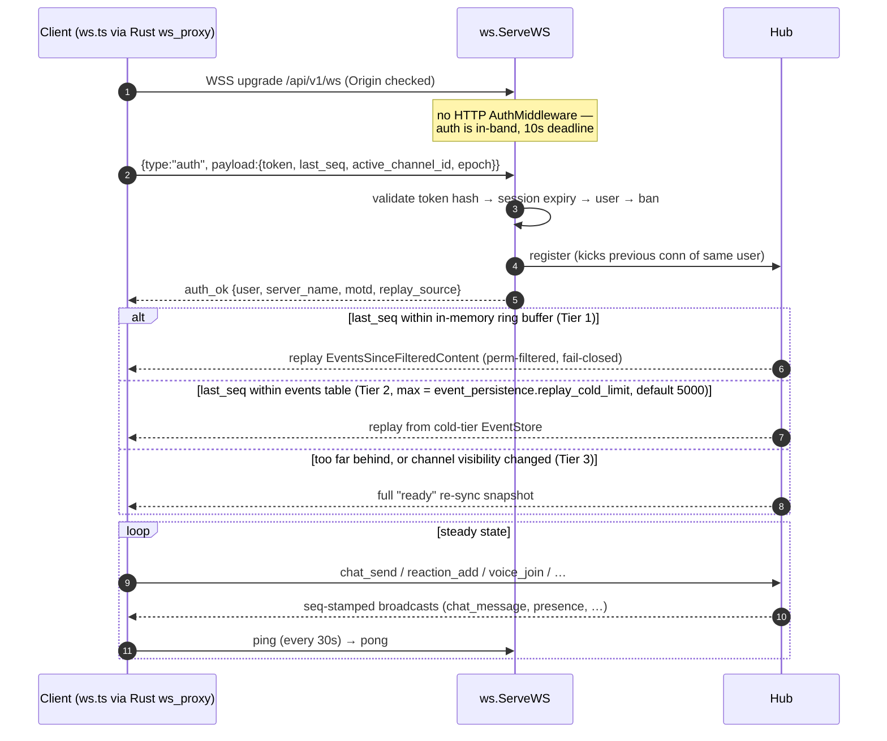
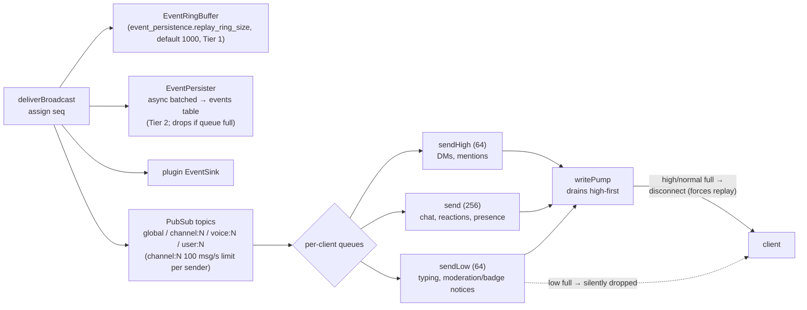
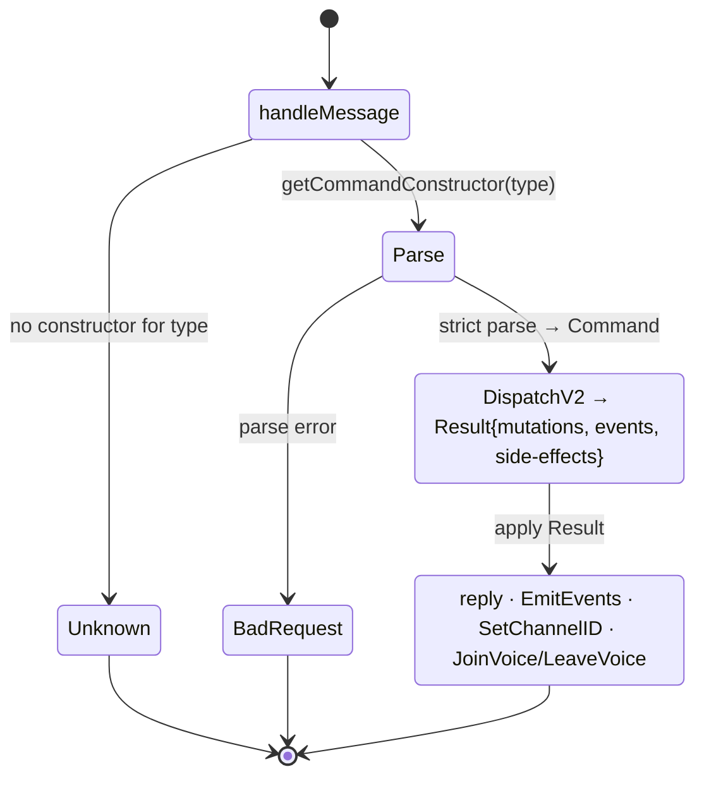

# WebSocket / Real-time Engine

**Verified against:** `origin/dev` at `ac6ffc4e`, 2026-10-13

This page explains how the server's real-time engine works: how a client
connects and signs in, how missed events are replayed after a reconnect, and
how the server protects itself from slow clients. Read it before you change
anything in `Server/ws/`.

The `Server/ws` package is the largest in the server, at about 18,000 lines of
production code. It contains:

- a single `Hub` that owns every client connection;
- a topic-based pub/sub;
- a sequence counter that only goes up;
- a 3-tier reconnect replay pipeline;
- one typed (V2) command dispatch.

Message-type constants are **generated**. `protocol/schema.json` is the single
source of truth. `Server/cmd/genprotocol` generates both
`Server/ws/message_types.go` and `Client/src/lib/protocolTypes.ts` from it
(`make protocol-generate`). CI fails on drift through `make protocol-verify`.
That includes the plugin command family (`chat_command`, `command_reply`,
`plugin_broadcast`), which is in the schema like every other type; its handler
is `Server/ws/handlers_command.go`. The wire formats are in
[protocol.md](../protocol.md).

## D4a — Connect, authenticate, replay

**What this shows.** Sign-in happens inside the socket on purpose: the WS route
is mounted without `AuthMiddleware`, and the first frame carries the token.

Every broadcast gets a `seq` number under a dedicated mutex, and `seq` only
goes up. On reconnect the client reports its `last_seq`, and the hub picks the
cheapest replay tier that can serve it.

- **Visibility changes.** A `visibilityChangeSeq` watermark forces a full
  re-sync whenever channel visibility changed while the client was away. So a
  permission change can never be bypassed by replay.
- **Shed frames.** A message frame dropped before it got a `seq` (by the topic
  limiter or a full dispatch queue) moves the same watermark. A client resuming
  at or behind that point recovers the message from the database.
- **Reporting.** `auth_ok.replay_source` (`none`, `buffer` or `db`) says which
  tier served the reconnect. It also feeds the `ws_reconnect_tier_total`
  metric.
- **Client input.** `active_channel_id` lets a resuming client re-declare its
  channel without a separate focus frame. A missing `epoch` is read as 0, the
  pre-epoch client. Both values come from the client, so the server validates
  them before use.

Neither replay tier has a fixed depth. They are set by the
`event_persistence.replay_ring_size` and `replay_cold_limit` config keys.

## D4b — Broadcast fanout and backpressure

**What this shows.** The overflow policy is deliberate.

- Dropping a chat message would leave the client with wrong state. So a full
  normal or high-priority queue disconnects the client, and replay restores
  consistency when it reconnects.
- Presence shares the normal queue but is the exception. A presence frame that
  finds the queue full is dropped and later repaired by a full presence
  snapshot (`Client.sendPresenceMsg`). That way a burst of reconnects cannot
  kick other clients.
- Typing, moderation and mention-badge notices may be lost by design.
- The global `broadcast` channel (1024) drops frames and counts them in
  `broadcastDrops` when it is full.
- A content frame in a channel that may be NSFW-labelled needs a database read
  (the label and who acknowledged it) before it can be numbered. That read runs
  off the dispatch loop, with a 1 s limit, while the frame waits in a lane for
  its channel; later frames for the same channel wait behind it, and every
  other frame keeps flowing. A read that fails or times out withholds the
  frame and moves the visibility watermark, so a resuming client re-syncs
  (`Server/ws/hub_content_gate.go`). Order within a channel is kept; a global
  frame can overtake a channel's frame that is still waiting.
- A server channel's frames go live only to that channel's topic, which is
  the focused channel (plus, after a resume mid-call, the voice channel; DM
  frames go to every participant), while a resume replays every readable channel. That
  difference is deliberate: see
  [channel-scope-decision.md](channel-scope-decision.md).

## D4c — Typed command dispatch

**What this shows.** Every inbound message type is parsed by its constructor
into a typed `Command`. One V2 handler runs it, and one applier applies the
handler's `Result`. The old V1 path is gone (audit A-2026-07-09, done
2026-07-20): there is no second parser and no second registry.

Handlers stay light on side effects. The two voice routines that touch the hub
directly (`handleVoiceJoin` and `handleVoiceLeave`) are triggered from the
applier through `Result.JoinVoice` and `Result.LeaveVoice`. They are also
called without throttling on a channel switch and on disconnect. A call that
ended is first held for 15 s so a resuming socket can take it over
(`voice_grace.go`).

### Voice membership

`voiceRegistry` owns voice membership in memory. It is the field `Hub.voiceReg`.
It holds the per-user membership lock and the 15 s reconnect grace window. Each
connection keeps its own slot in `Client.voice` (channel, join token, completed
flag, E2EE announce and any moderator mute stash). The durable half is the
`voice_states` row.

The hub holds one connection per device session, not per account:
`Hub.clients` maps a user id to all of that user's live connections
(`hub_conns.go`), and `PubSub` keys subscribers by `*Client`. A new connection
replaces only one with the same `tokenHash`; the cap is `maxConnectionsPerUser`
(10). A per-user lookup is one of `clientsOf` (fan-out to every device),
`isConnected` (presence) or `voiceClient` (the one connection holding the
account's call). A second device's `voice_join` moves the call.

Writes go only through the `voiceTxn` handle, with two exceptions: the lock-free `onClientEvent` handle (the test-only registration path) and the `setE2EE` key store. A path takes it once with
`h.begin(uid)`, which locks that user's voice membership, and releases it with
`txn.end()`. Helpers it calls take the handle as a parameter and never lock
again. The handle's operations are:

- `persistJoin`: insert the row under capacity, read it back, set the slot.
- `markCompleted`: flag the join as complete and subscribe to the voice topic.
- `clear`, `clearIfChannel`, `clearExact`: empty the slot and unsubscribe.
- `deleteRow`: remove the `voice_states` row for one join instance.
- `transfer`: move the whole slot from a replaced connection to its successor.
- `park`, `inherit`, `takeParked`, `takeParkedOfSession`: hold, claim or drop the
  grace entry. Only the parking connection's own session may inherit it.
- `stashModFlags`, `setJoinToken`: keep a moderator mute across a move, and
  set the join token.

At shutdown the hub calls `voiceReg.close()`. It stops every grace timer and
leaves the rows for the next boot to wipe. Reads need no handle:
`c.voice.channel()` and `c.voice.state()` take only the slot's own mutex.

The lock order for the whole package, voice locks included, is written in
`Server/ws/lock_order.go`. A goroutine holds at most one user's member lock.
The hub dispatch goroutine never takes it. The voice-specific rules are in the
header comment of `Server/ws/voice_registry.go`. The `voice-membership-writes`
invariant fails CI if code outside `ws/voice_registry*.go` writes the slot or a
membership row.

### What else the Hub owns

| Job                           | Schedule and detail                                                                                                                                                                  |
| ----------------------------- | ------------------------------------------------------------------------------------------------------------------------------------------------------------------------------------ |
| Stale-client sweep            | every 30 s; a client idle for 90 s is removed. Each connection's protocol Ping every 25 s refreshes activity and closes a peer that misses a Pong                                    |
| Revoked-session sweep         | every 30 s, plus a check every 10 messages per connection, plus an immediate check for one account (`DisconnectIfSessionRevoked`) after a password or 2FA change or a session revoke |
| Stale-voice-state sweep       | every 60 s                                                                                                                                                                           |
| LiveKit membership reconciler | every 60 s (`voice_reconcile.go`; see [livekit-setup.md](../livekit-setup.md))                                                                                                       |
| Removed-participant watch     | every 2 s, only while an SFU identity the server removed is still within its token lifetime (`voice_removed_watch.go`)                                                               |
| Channel-activity worker       | coalesces unread hints for unfocused readable channels; leading-edge 1 s window (`channel_activity.go`, WP 2B-2)                                                                     |
| Role-refresh worker           | fans a committed role change out per affected user, off the request goroutine; coalesces pending users (`role_refresh.go`, WP 4.4b, see below)                                       |
| Panic containment             | on the run loop: 3 panics in 60 s, or one Windows memory fault (SRE-08), stops the hub and exits the process                                                                         |
| LiveKit client and subprocess | the client, and the optional managed `livekit-server` process                                                                                                                        |
| Voice E2EE key-holder map     | see [voice-e2ee.md](voice-e2ee.md)                                                                                                                                                   |

Each sweep and watch tick runs with a timeout under the hub's lifecycle
context. So `Stop` cancels it and `Done()` waits for it (`hub_sweep.go`,
`hub_stop.go`). The two coalescing workers run on that context too, and
`finishRun` joins them.

**Role-refresh worker (WP 4.4b).** The role, channel and moderation services
(WP 5.1a) commit, invalidate the permission cache and then call the hub through
the `service.PermissionChangeNotifier` port, which `ws/permission_notifier.go`
implements. A role mutation becomes one `Hub.EnqueueRoleRefresh` call and never
waits on the fan-out. For the members it names directly (a role delete's first
32 members, a single role assignment) the service also calls
`Hub.RevokeUnreadableChannels`, so their held channels are released before the
call returns. Because the services own this, a caller other than an admin
handler gets the same effects. The worker takes the pending users in rounds. Each affected
member's held topics are released before their sidebar is sent. For each
user whose role changed it revokes held topics first, then sends
`channel_create`/`channel_delete` in chunks (a client that does not drain is
kicked, never sent `BANNED`), then paces `member_update` with the role name
read at send time, redelivers the timeout views to those users only, and ends
with one `roles_update`. A user who reconnects while its refresh is pending or
running takes a full `ready`; every other reconnect still resumes by replay. A
crash or restart drops what is pending, and clients converge on reconnect from
committed state.

**Lock order for the worker.** `roleRefreshState.mu` is a leaf: it may be taken
under `seqMu` (the reconnect check calls `covers`) and `seqMu` is never taken
under it. It is never held across I/O or a send, or while taking `h.mu`,
`timeoutView.mu` or any `Client.mu`. `flushMu`, which serialises rounds, sits
above everything a round takes, and enqueue never takes it. The
channel-activity coalescer follows the same rule (`activity.mu` is a leaf,
`flushMu` above it).

Collaborators are passed in up front through the validated `ws.HubOptions`
(`Server/ws/hub_options.go`). `NewHub` runs `validateHubOptions` before it
builds anything, so an incomplete hub fails at construction, not at first use.
The event-persistence pair is still attached after the hub is running
(`SetEventPersister` / `SetEventStore`, from
`Server/internal/app/persistence.go`). That hot-swap after `Run` is the timing
dependency the audit note names.

**Source of truth:** `Server/ws/hub.go`, `Server/ws/hub_content_gate.go`, `Server/ws/role_refresh.go`, `Server/ws/serve.go`,
`Server/ws/client.go`, `Server/ws/handlers.go`, `Server/ws/command.go`,
`Server/ws/pubsub.go`, `Server/ws/ringbuffer.go`, `Server/ws/event_persister.go`,
`Server/ws/message_types.go`, `Server/migrations/014_events_table.sql`.
