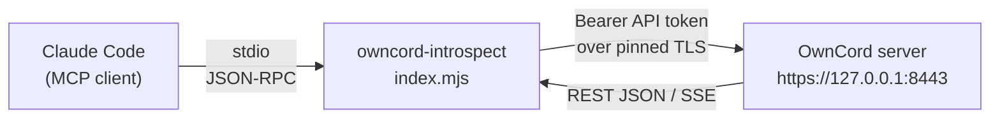
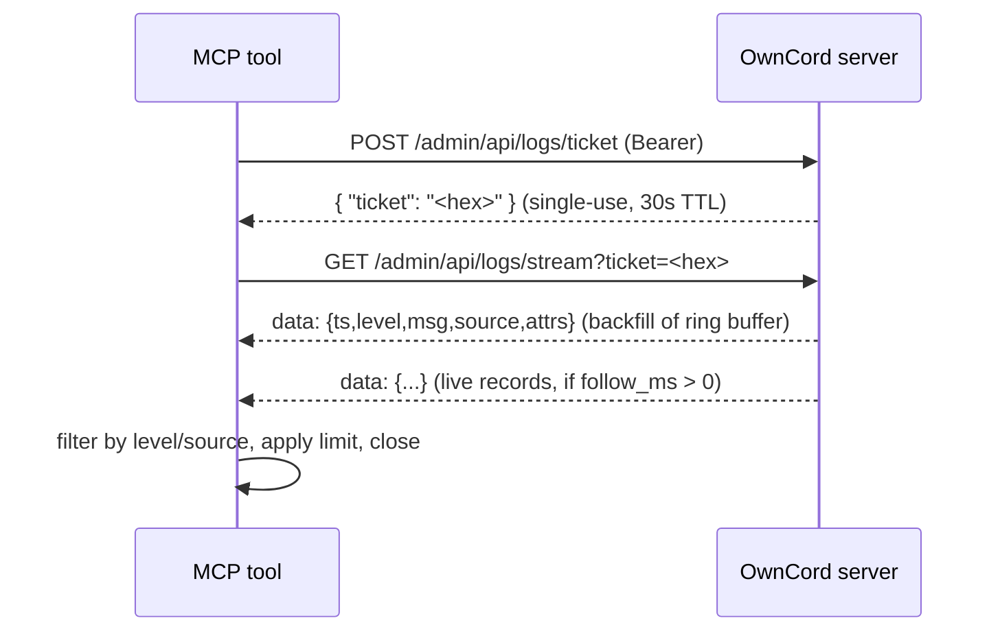

# OwnCord Introspection MCP Server

This page is for developers who want an AI agent, such as Claude Code, to look
inside a **locally running** OwnCord server. It explains how the tool works,
how to set it up, and what each of its two tools does.

`tools/mcp-introspect/` is a small [Model Context Protocol](https://modelcontextprotocol.io)
(MCP) server. MCP is a standard way for an AI agent to call outside tools.
This one lets the agent read the server's logs and call any REST endpoint.

It is a **development tool**, not part of the shipped product. It holds no data
of its own and adds nothing to the server binary. It is a thin wrapper over
OwnCord's existing REST API.

- **Code:** `tools/mcp-introspect/index.mjs` (MCP wiring) and `transport.mjs` (HTTP/SSE).
- **Runtime:** Node 26 (`engines` in its `package.json`), ES modules. Its
  dependencies are `@modelcontextprotocol/sdk` and `zod`.
- **Registration:** a local `.mcp.json` at the repository root, plus
  `.claude/settings.local.json`. Both are gitignored, so you create them
  yourself (see [Setup](#setup)).

---

## How it works



Claude Code starts `index.mjs` as a child process
(`node tools/mcp-introspect/index.mjs`) and talks MCP to it over stdin and
stdout. When you or the agent call one of its tools, it sends a request to the
local OwnCord server and returns the result.

### Request deadlines

API and log-ticket requests have a 15-second total deadline, including response
bodies. Log streams have 15 seconds to receive headers. After headers, a
backfill closes after 300 ms of quiet or 15 seconds total; live following runs
for the requested `follow_ms`, capped at 60,000 ms. Completion, errors and
timeouts close the request and clear its timers. Timeout messages omit tokens
and log-ticket URLs. Run the offline transport tests from the repository root:
`node --test tools/mcp-introspect/transport.test.mjs`.

### Authentication

OwnCord has no static API key. The only credential its API accepts is a
**bearer token**. A normal login gives you one, but this tool uses a
long-lived **API token** instead (see [API tokens](#api-tokens-server-side)):

- You create a token once with `server token create`. It writes straight to
  the database, with no login.
- The tool sends it as `Authorization: Bearer <token>` on every request. It
  reads the token from `OWNCORD_API_TOKEN`.
- On the server, `auth.ResolveTokenHash` resolves the bearer token. It checks
  login **sessions first**, then falls back to API tokens. The token acts as
  the user it is bound to (the owner by default) and gets that user's role.
  That is why it can reach `/admin/api/*` and the log stream.

The tool never sends an `Origin` header. Where the server checks `Origin`, a
missing header means a non-browser client, so the cross-origin check does not
block it.

### TLS (certificate pinning, not CA trust)

OwnCord serves HTTPS with a **self-signed certificate that has no SAN**
(Subject Alternative Name). Trusting it as a certificate authority is not
enough, because the hostname check against `127.0.0.1` still fails. So the tool
uses `node:https` and:

1. **pins** the exact certificate (`ca: Server/data/cert.pem`); and
2. **skips the hostname check** (`checkServerIdentity: () => undefined`).

The pin proves the server's identity. An attacker in the middle would need the
identical certificate. This is the same trust-on-first-use model the desktop
client's proxy uses.

### The two tools

**`api_request`** is one general passthrough that covers the _whole_ REST API.
It selects HTTP or HTTPS from the URL and sends one request with the
bearer token. It returns `{ status, headers, body }`. The body is parsed as
JSON when possible, otherwise it is raw text. Any HTTP method is allowed,
including destructive admin routes.

**`server_logs`** reads the server's recent logs.

- The server keeps its last 10000 log records in an in-memory ring buffer. It
  serves them as **Server-Sent Events (SSE)**, a one-way stream over HTTP.
- An `EventSource`-style stream cannot send an auth header, so the stream is
  guarded by a single-use ticket. The tool runs that flow:



- With `follow_ms: 0` (the default), it returns once the burst of buffered
  records goes quiet.
- With `follow_ms` above 0, it keeps reading live records for that many
  milliseconds.
- The `level` and `source` filters and the `limit` are applied by the tool,
  not the server.

The desktop client's log is **not** a tool. It is a normal file at
`%LOCALAPPDATA%\com.owncord.client\logs\owncord-client.log`, so read it with the
agent's own file tools.

---

## Setup

### 1. Install dependencies

```bash
cd tools/mcp-introspect
npm install
```

### 2. Create an API token

```bash
cd Server
./chatserver.exe token create --label mcp-introspect
# prints the raw token ONCE. Copy it now; it cannot be shown again.
```

Use the name of your own server binary (`chatserver` on Linux).

- The token is bound to the **owner** account by default, so it can reach the
  admin API and the log stream.
- Bind it to a different user with `--user <name>`.
- Set an expiry with `--expires 720h`. Without it, the token never expires.
- List tokens with `token list`, and revoke one with
  `token revoke <id|label>`.

> The running server must be built from current source. API-token auth is
> compiled into the server binary. If needed, rebuild
> (`go build -o chatserver.exe .`) and restart.

### 3. Put the token in your environment

On Windows:

```powershell
setx OWNCORD_API_TOKEN <paste-raw-token>   # Windows user environment; open a new shell afterwards
```

On Linux or macOS, `export OWNCORD_API_TOKEN=<paste-raw-token>` in your shell
profile.

### 4. Register the server with Claude Code

`.mcp.json` and `.claude/settings.local.json` are gitignored, so each developer
creates their own. Add an `owncord-introspect` entry to `.mcp.json` at the
repository root that runs `node tools/mcp-introspect/index.mjs` and passes
`OWNCORD_API_TOKEN` through. For example:

```json
{
  "mcpServers": {
    "owncord-introspect": {
      "command": "node",
      "args": ["tools/mcp-introspect/index.mjs"],
      "env": { "OWNCORD_API_TOKEN": "${OWNCORD_API_TOKEN}" }
    }
  }
}
```

Then allow it in `.claude/settings.local.json` under `enabledMcpjsonServers`,
and restart Claude Code so it picks up the new MCP server. Keep the token
itself out of `.mcp.json`.

### Check it works

```bash
cd tools/mcp-introspect
npx @modelcontextprotocol/inspector node index.mjs
```

The two tools should appear. Call `api_request` with
`{ "method": "GET", "path": "/health" }` and expect `{status:200, body:{...}}`.

---

## Tool reference

### `api_request`

| Param     | Type    | Notes                                                                  |
| --------- | ------- | ---------------------------------------------------------------------- |
| `method`  | string  | `GET`, `POST`, `PATCH`, `PUT`, `DELETE`                                |
| `path`    | string  | Path starting with `/` (for example `/admin/api/stats`), or a full URL |
| `query`   | object? | Query-string parameters                                                |
| `body`    | any?    | JSON body (object or string)                                           |
| `headers` | object? | Extra request headers                                                  |

Returns `{ status, headers, body }`.

```jsonc
// request
{ "method": "GET", "path": "/api/v1/metrics" }
// → { "status": 200, "headers": {...}, "body": { "uptime_seconds": 1820,
//     "goroutines": 42, "connected_users": 1, "voice_sessions": 0, ... } }
```

Useful read-only endpoints:

- `/health`
- `/api/v1/metrics` (runtime and process stats)
- `/admin/api/stats` (user, message and channel counts)
- `/api/v1/diagnostics/connectivity`
- `/admin/api/users`, `/admin/api/channels`, `/admin/api/audit-log`

### `server_logs`

| Param       | Type    | Default | Notes                                                                                      |
| ----------- | ------- | ------- | ------------------------------------------------------------------------------------------ |
| `level`     | string? | —       | `DEBUG` \| `INFO` \| `WARN` \| `ERROR`                                                     |
| `source`    | string? | —       | `websocket`, `http`, `admin`, `auth`, `database`, `storage`, `updater`, `config`, `server` |
| `limit`     | number? | 500     | Most records to return                                                                     |
| `follow_ms` | number? | 0       | `0` = buffered records only; above 0 = also stream live records for that many ms           |

Returns an array of `{ ts, level, msg, source, attrs }`. `attrs` is parsed from
its JSON string when present. `req_id` and `trace_id` appear inside `attrs`.

```jsonc
{ "level": "ERROR", "limit": 50 }              // last 50 ERROR records from the ring buffer
{ "source": "websocket", "follow_ms": 3000 }   // ws logs: buffered records plus 3 s of live tail
```

---

## Configuration

Everything is optional except `OWNCORD_API_TOKEN`, which both tools need.

| Environment variable | Default                           | Purpose                                                                                                          |
| -------------------- | --------------------------------- | ---------------------------------------------------------------------------------------------------------------- |
| `OWNCORD_API_TOKEN`  | _(required)_                      | Bearer token from `server token create`                                                                          |
| `OWNCORD_BASE_URL`   | `https://127.0.0.1:<server.port>` | Replace the whole base URL (for example a non-TLS endpoint). The port is read from `Server/config.yaml`, or 8443 |
| `OWNCORD_CERT_PATH`  | `Server/data/cert.pem`            | The self-signed certificate to pin                                                                               |

---

## Troubleshooting

| Symptom                                   | Cause and fix                                                                                                                                                                                                                       |
| ----------------------------------------- | ----------------------------------------------------------------------------------------------------------------------------------------------------------------------------------------------------------------------------------- |
| `OWNCORD_API_TOKEN is not set`            | Create a token and set the variable. Restart the shell and Claude Code so they pick it up.                                                                                                                                          |
| `OwnCord cert not found at …`             | Start the server once to create `Server/data/cert.pem`, or set `OWNCORD_CERT_PATH` or `OWNCORD_BASE_URL`.                                                                                                                           |
| `api_request` returns `401`               | The token is missing, revoked or expired. Create a fresh owner-bound token.                                                                                                                                                         |
| `api_request` returns `403` on `/admin/*` | Either the request did not come from an allowed IP (run the tool on the same host as the server; localhost is allowed by default), or the token's user lacks the permission that route needs. See the route table in `docs/api.md`. |
| `server_logs` fails at the ticket step    | The log stream needs the ADMINISTRATOR permission. The wider `/admin/api/*` access does not open it. Or the server is not a current build.                                                                                          |

---

## Security notes

- **Local only, by design.** The tool talks to `127.0.0.1` and relies on the
  server's localhost admin IP check. Do not expose it, or point it at a remote
  host, without understanding the trust model.
- **`api_request` can read and write anything.** It can call any endpoint with
  any method, including destructive admin routes: delete users or channels,
  restore backups, apply updates. There is no write allowlist. It relies on the
  judgement of whoever is using it.
- **The API token is a real credential.** By default it never expires, and it
  has the owner's permissions. Keep it out of version control. It belongs in
  your environment, not in `.mcp.json`. Revoke it with `server token revoke`
  if it leaks.

---

## API tokens (server side)

The MCP tool relies on a server feature: revocable, long-lived **API tokens**.
See the `api_tokens` table in [`schema.md`](schema.md) and the `server token`
subcommands. Key points:

- They are stored hashed (SHA-256), like sessions. The raw token is shown once,
  when it is created.
- The same middleware as sessions resolves them (`auth.ResolveTokenHash`).
  **Sessions are matched first**, so normal logins behave as before. API tokens
  are a fallback.
- `expires_at IS NULL` means the token never expires. `revoked_at IS NULL`
  means it is active. Revoking takes effect at once.
- They live in a separate table from `sessions`, so the per-user session limit
  never touches them. `server token revoke` ends one at once. Which other
  actions revoke them is in [`docs/api.md`](api.md#api-tokens).
