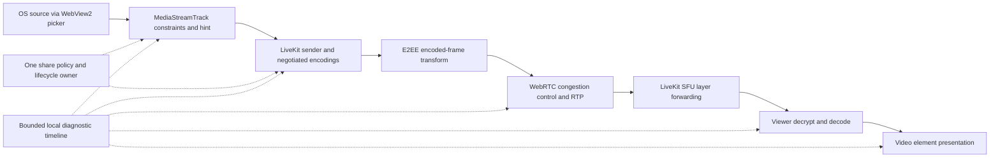

# Screen-sharing performance and pipeline plan

**Status:** design only, 2026-10-25. No implementation or performance qualification has been completed by this plan.
**Related:** [issue #2805](https://github.com/J3vb/OwnCord/issues/2805).
**Inspected baseline:** `dev` at `1184d69c4239a71eb856bb0eec12483eccf401c1`; LiveKit JS `2.22.3` in `Client/package-lock.json`; managed SFU default `1.13.7` in `Server/ws/livekit_download.go`. Record the actual externally configured SFU version in every trial.
**Authority:** [plan index](README.md); [current project status](../STATUS.md). This plan proposes reliability work for existing sharing, not a new release commitment.

## Decision and boundaries

Keep the Windows WebView2 capture → LiveKit WebRTC → SFU pipeline while measuring where it loses throughput. Make source delivery, each encoder layer, network delivery, and viewer presentation separately observable. Introduce a motion-oriented sharing policy only after controlled experiments. Retain a text-oriented policy. Keep software encoding as a supported, bounded fallback; qualify 720p30 before promising 1080p60 on a software encoder.

Do not globally disable simulcast. Compare its CPU/uplink cost against its benefit for heterogeneous viewers. One encoded stream uploaded to an SFU can serve many viewers; the publisher does not encode once per viewer. Multiple simulcast encodings are separate versions of one publication, not IP multicast. One SVC encoding can contain several temporal/spatial layers and still has encoding cost.

E2EE stays enabled in all acceptance runs. Preserve the peer decode intersection and lifecycle guards. No SFU transcoding, custom browser flags, codec dependency changes, native Windows video encoder, or native capture replacement ships as part of this planning PR. A native prototype is a conditional later phase, not the initial fix.

## Evidence: what is known and what remains open

### Issue evidence

The [issue body](https://github.com/J3vb/OwnCord/issues/2805) reports Windows 11, WebView2, client/server 2.4.0 beta 1, Ryzen 9 7950X, RTX 5060 Ti and 64 GB RAM. Motion makes the stream fall to 20–40 FPS and sometimes 5–10 while the game stays above 100 FPS. OBS virtual-camera input reportedly sustains 60 FPS. These are user observations, not a controlled benchmark.

The [maintainer response](https://github.com/J3vb/OwnCord/issues/2805#issuecomment-6395131727) attributes a known H.264 problem to software encoding and describes a dev fix. The [reporter's subsequent response](https://github.com/J3vb/OwnCord/issues/2805#issuecomment-6396545406) says VP8 is in use, suggests reproducing with a fast-game video in a captured window, and says whole-monitor capture sometimes helps. Therefore H.264 profile selection is relevant but cannot establish the cause of this VP8 report. Beta and dev need separate measurements.

The referenced conversation describes a 17 FPS / 58 capture FPS display. Its original image is unavailable in this inspection; the later issue attachment also could not be fetched through the research tool. Do not invent its codec, encoder, limitation reason, layer, or resolution. Request a fresh diagnostic export during reproduction. If 58 is a real source measurement and 17 is the active outbound measurement in the same interval, throughput is falling after source delivery; the numbers alone do not distinguish encoder overload, resource adaptation, bandwidth control, or layer selection. If 58 comes from `getSettings()`, it is a configured track rate rather than a measured source rate.

### Confirmed code behavior at the baseline

All paths below are relative to the repository root. Function names identify inspection anchors; comments describing earlier experiments are historical claims, not new measurements.

| Area and exact path                                                                                                                  | Confirmed behavior and implication                                                                                                                                                                                                                                                                                                                                                                                                                                                            |
| ------------------------------------------------------------------------------------------------------------------------------------ | --------------------------------------------------------------------------------------------------------------------------------------------------------------------------------------------------------------------------------------------------------------------------------------------------------------------------------------------------------------------------------------------------------------------------------------------------------------------------------------------- |
| `Client/src/lib/screenShare.ts`: `enableScreenshare`, `getScreenShareCaptureOptions`, `screenVideoPublishOptions`                    | Windows uses `createLocalScreenTracks` and manual LiveKit publication. Medium is 720p, high is 1080p, source has no explicit size cap. The default is medium/30. Medium/high/source request `detail`; low defaults to 5 FPS, with 60/120 explicit overrides subject to offered rates. Capture constraints and publish caps are different controls.                                                                                                                                            |
| Same file: `getScreenShareMaxBitrate`, `screenShareDegradation`                                                                      | Base video caps are 1.5/3/6/10 Mbps for low/medium/high/source; multipliers are 1.5 at 60 and 2 at 120. High/60 therefore has a 9 Mbps top-layer cap, not a guaranteed bitrate or total uplink budget. Effective FPS below 120 uses `maintain-resolution`; 120 uses `balanced`.                                                                                                                                                                                                               |
| Same file: `videoLayerOptions`, `isScreenShareSimulcast`, `SCREENSHARE_SIMULCAST_LAYERS`                                             | VP8/H.264 medium and high except high/120 request simulcast, with one configured lower 720p/15 layer capped at 1.2 Mbps. Source and low do not. VP9 sets `simulcast:false`. Verify the actual RID list: at medium resolution a proposed lower layer is not necessarily a distinct spatial layer.                                                                                                                                                                                              |
| `Client/src/features/voice/roomLifecycle.ts`: `createRoom`                                                                           | Webview rooms explicitly disable `adaptiveStream` because the grid uses its own `MediaStream`, without LiveKit `attach()`. Dynacast is set from **camera** quality (`!isSource`), not screen quality. E2EE is explicitly enabled. Do not turn adaptiveStream on without fixing visibility/attachment integration.                                                                                                                                                                             |
| `Client/src/features/voice/videoCodec.ts`: `resolvePreferredCodec`, `h264GpuProfiles`, `pickAutoCodec`                               | VP8 is the saved default. Auto and high-rate logic use MediaCapabilities and renderer information; explicit Windows H.264 bypasses that probe on a known non-Intel, non-software renderer and marks Main/High preference. Explicit VP9 uses capability checks. These are selection heuristics, not runtime proof of hardware encoding.                                                                                                                                                        |
| `Client/src/lib/h264Profile.ts`: `setH264GpuProfiles`, `applyH264GpuProfiles`                                                        | A once-installed `createOffer` wrapper sets codec preferences on marked transceivers, removes Baseline H.264 where alternatives exist, and restores defaults after unpublish. Dev includes this via commit `502389af` / PR #2747. It does not guarantee hardware operation for every GPU, frame size, profile, or driver.                                                                                                                                                                     |
| `Client/src/features/voice/codecSwitch.ts`: `CodecSwitchController`                                                                  | Existing controller serializes republish, coalesces peer downgrade for 1.5 s, waits 10 s stable and a 30 s minimum gap for upgrades. H.264 share encoder is checked after 4 s, retried once if unnamed; an OpenH264 name triggers VP8 for that share. The input sample exposes one selected layer, so a software-only lower layer can be missed if only the top layer names hardware.                                                                                                         |
| `Client/src/features/voice/decodeCaps.ts`, `peerDecode.ts`                                                                           | Unknown/empty peer capabilities mean baseline VP8/H.264. VP9/H.265 require common support. AV1 is excluded by the current E2EE decryptable set. Retain those guards; advertised codec support alone does not establish compatible H.264 profiles.                                                                                                                                                                                                                                             |
| `Client/src/features/voice/shareSenderStats.ts`: `senderSample`, `senderSampleFromReport`, `readSenderSample`                        | Source FPS prefers a `media-source` report, falling back to `getSettings().frameRate`. Display FPS is the maximum across layers; dimensions/reason/encoder come from the widest active layer, falling back to all layers if none is active. Rates currently include inactive entries. Source entries are not explicitly joined through `mediaSourceId`; samples expose neither timestamp nor RID. These are observable aggregation limitations, not proof that they caused the reported drop. |
| `Client/src/components/VideoGrid.ts`, `Client/src/components/video-grid/stream-info.ts`, `Client/src/features/voice/remoteTracks.ts` | Local sender readout polls every 2 s. Remote FPS is derived from decoded-frame deltas; it is not a direct measurement of presentation cadence. Existing UI gives useful data but no synchronized full-pipeline trace.                                                                                                                                                                                                                                                                         |
| `Client/src/features/voice/screenshareChange.ts`: `setScreenshareQuality`, `setTopLayer`                                             | Quality changes apply capture constraints, update screen encoding, replace the track and set top-layer bitrate/FPS. They do not reconstruct the complete policy from `screenVideoPublishOptions`. Source and codec switches already carry generation/staleness checks; new policy application must cover all these entry points.                                                                                                                                                              |
| `Client/src-tauri/src/windows_media.rs`, `Client/src-tauri/src/lib.rs`, `Client/src-tauri/tauri.conf.json`                           | Windows native code grants app-origin camera/mic permissions; screen permission retains its picker. Config has browser arguments but no `disable-gpu`. This is not an OwnCord-controlled WGC/DXGI video-capture implementation. Browser rendering acceleration and video encoding acceleration must be diagnosed separately.                                                                                                                                                                  |
| `Client/src/features/voice/native/screenTrack.ts`, `Client/src-tauri/src/native_voice/screen.rs`, `session.rs`, `stats.rs`           | Linux uses a separate native media engine. It must receive regression coverage, but changing Linux native capture is not a Windows WebView2 fix.                                                                                                                                                                                                                                                                                                                                              |
| `Server/api/livekit_proxy.go`, `Server/ws/livekit.go`, `livekit_process.go`, `livekit_download.go`                                   | OwnCord manages signalling/tokens/SFU lifecycle; browser media goes to LiveKit. No application-level server transcoder is part of this path. Inspect managed versus external SFU configuration before blaming the app HTTP proxy for RTP performance.                                                                                                                                                                                                                                         |

### Official upstream constraints

- The [pinned LiveKit LocalParticipant implementation](https://github.com/livekit/client-sdk-js/blob/v2.22.3/src/room/participant/LocalParticipant.ts#L1154-L1175) forces screen-share SVC to `L1T3` and changes the track hint to `motion`. Thus current VP9 sharing has one spatial resolution with three temporal layers, not the general three-spatial-layer default. Its [backup codec publication condition](https://github.com/livekit/client-sdk-js/blob/v2.22.3/src/room/participant/LocalParticipant.ts#L1186-L1205) excludes E2EE. Inspect [encoding construction](https://github.com/livekit/client-sdk-js/blob/v2.22.3/src/room/participant/publishUtils.ts) and [publish options](https://github.com/livekit/client-sdk-js/blob/v2.22.3/src/room/track/options.ts) when changing topology. Pin any upstream experiment; do not infer installed behavior from `main`.
- [LiveKit's media guidance](https://docs.livekit.io/transport/media/advanced/) describes per-recipient layer forwarding and unused simulcast-layer pausing through dynacast. Its general VP9/AV1 spatial-SVC default is not the screen-specific behavior above. SVC dynacast can pause the stream, not independently stop its spatial layers. Removing spatial alternatives can leave slow viewers with no suitable resolution. Evaluate encoder load and viewer outcomes together.
- [W3C stats](https://www.w3.org/TR/webrtc-stats/) distinguish track-source delivery before encoding from outbound RTP, and expose cumulative counters for interval calculations. Optional implementation fields may be absent. A healthy source rate is not proof of a healthy encoder or receiver. See the proposed instrument inventory below.
- [Content-hint guidance](https://www.w3.org/TR/mst-content-hint/) treats `motion` versus `detail` as preferences. [WebRTC adaptation code](https://webrtc.googlesource.com/src/+/1bd545a91eff11aef4be89ee57a56ca3b2cf8f8a/call/adaptation/video_stream_adapter.cc) chooses frame-rate reduction for maintain-resolution and resolution reduction for maintain-framerate. Neither preference creates processing capacity; read back and measure the runtime result.
- [Chromium desktop capture source](https://chromium.googlesource.com/chromium/src/+/079ad5b81506fb387ec158e184ff95535c3b9f92/content/browser/media/capture/desktop_capture_device.cc) includes capture CPU pacing, screen/window distinctions and unchanged-content suppression. Those mechanisms justify capture experiments; this source revision is not proof of the exact capture backend in the installed WebView2 runtime. Record its version and correlate a runtime trace before attributing WGC/DXGI behavior.
- Microsoft's [WebView2 performance guidance](https://learn.microsoft.com/en-us/microsoft-edge/webview2/concepts/performance) recommends retaining GPU rendering. Its [browser-flags guidance](https://learn.microsoft.com/en-us/microsoft-edge/webview2/concepts/webview-features-flags) limits flags to development diagnostics. Do not ship GPU-blocklist overrides or experimental capture flags as a repair.
- Discord's [2024 Go Live engineering overview](https://discord.com/blog/how-it-all-goes-live-an-overview-of-discords-streaming-technology) describes capture fallbacks, hardware codecs, viewer-compatible negotiation, backend forwarding and measurements of cadence/latency/resource usage. It describes transmission constrained by the slowest viewer; it does not establish a current universal single-stream or simulcast policy. Its [Windows capture explanation](https://support.discord.com/hc/en-us/articles/9410427556375--Windows-Capturing-Application-Window-for-Screen-Share-and-Go-Live) describes WGC, other capture techniques and fullscreen limitations. Adopt the measurement/fallback principles; do not infer that OwnCord's browser pipeline has Discord's native capture access or should copy its topology.

### Hypotheses and decisive evidence

| Hypothesis, not a diagnosis                            | Expected signature                                                                                                                        | Discriminating experiment                                                                                                             |
| ------------------------------------------------------ | ----------------------------------------------------------------------------------------------------------------------------------------- | ------------------------------------------------------------------------------------------------------------------------------------- |
| CPU/software encoder saturated, possibly on one thread | Source delivery stays high; per-layer encoding falls; encode time/resource limitation rises; process/per-thread CPU identifies contention | Same source, codec and bitrate: current topology versus single stream versus cheaper lower layer; repeat with verified hardware H.264 |
| `detail` plus maintain-resolution sacrifices motion    | Output dimensions stay fixed while FPS drops under load                                                                                   | 2×3 hint/degradation experiment with identical codec, capture constraints and topology                                                |
| Window capture/compositor/GPU-copy bottleneck          | Source delivery falls before encoding, or native trace shows capture/copy delay                                                           | Same deterministic motion as window versus monitor, matched actual size/rate; game uncapped versus capped; Edge versus WebView2       |
| Available bandwidth / SFU allocation limits            | High source rate, bandwidth limitation, falling target bitrate, RTT/loss/send-delay rise; viewer allocation changes                       | Clean LAN versus separately impaired publisher uplink and viewer downlinks; fixed topology and codec                                  |
| Viewer decoder/rendering pressure                      | Healthy selected outbound stream but decoded or presented rate falls on one viewer                                                        | Hardware/software decode comparison, one versus many visible tiles, renderer long tasks and frame callbacks                           |
| Readout combines stale/different layers                | Display disagrees with per-RID counters, active flags or source identity                                                                  | Synthetic stats fixtures plus raw report export; no media-policy change needed to prove it                                            |
| Profile/codec/E2EE incompatibility                     | Published codec/profile or encoder differs from intent; decode/authentication failure despite outbound frames                             | Exact-profile offer/answer evidence, mixed clients, peer join/leave, E2EE always enabled                                              |

OBS virtual camera changes capture path, pacing, resolution and encoder treatment. Normalize all four before treating its success as evidence against either capture or encoding.

## Target architecture

Keep capture, sender adaptation and receiver presentation separate. The browser owns hardware capture/encode choices; OwnCord supplies policy and observes results. Keep E2EE transforms and the SFU forwarding model. Avoid frame-by-frame JS/canvas readback or a CPU-copy bridge in the production path.

Propose one pure `SharePolicy` resolver under `Client/src/features/voice/` (new module in implementation PR 3) describing intent, capture ceiling, effective hint, codec constraints, layer topology, total planned budget and degradation preference. One generation-owned application path handles initial publish, source replacement, quality changes, codec fallback and reconnect. Reuse the existing controller and state rather than adding independent republish timers. Never change camera behavior merely because screen-share intent changes.

Candidate policies to benchmark, not defaults approved here:

| Intent / device outcome     | Candidate                                                                                          | Decision gate                                                                                                   |
| --------------------------- | -------------------------------------------------------------------------------------------------- | --------------------------------------------------------------------------------------------------------------- |
| Text/documents              | `detail`, maintain-resolution, existing compatible simulcast                                       | Text correctness/readability; static low FPS is acceptable, scrolling is tested separately                      |
| Motion, verified hardware   | `motion`, maintain-framerate or measured balanced, compatible two-layer topology                   | 1080p60 cadence and mixed-viewer gates; no assumption that hardware works on every layer                        |
| Motion, software or unknown | Start by qualifying 720p30; compare single stream with a 360p/15 low layer, then optionally 720p60 | CPU budget and slow-viewer gate; reduce resolution before advertising sustainable high FPS                      |
| VP9-capable room            | Existing pinned `L1T3` as a separate arm                                                           | Temporal adaptation is useful but gives no lower spatial resolution; test slow viewer decode and bitrate limits |
| High/120 or uncapped source | Preserve current opt-in behavior until separately qualified                                        | No extrapolation from 60 FPS results; multi-GPU, high-refresh and large-frame trials required                   |

AV1 is deferred until the E2EE path and every supported receiver are validated; a GPU capability advertisement does not lift that restriction. H.265 remains explicitly gated and is not a general fallback. Keep Intel compatibility exclusions until an E2EE interop trial at the exact profile demonstrates they can be removed.

## Phase 0 — capture a reproducible baseline

Owner: media/client maintainer. Deliver a sanitized experiment record before selecting a fix.

1. Compare an unmodified beta.1 binary with a build of the inspected dev SHA on the reporter's machine if available and at least one independent Windows machine. Record client commit/build, Windows build, WebView2 runtime, GPU driver, adapter used for rendering and encoding, power mode, display refresh/DPI/HDR, source kind and actual dimensions, game FPS cap, codec preference and negotiated codec/profile, SFU version/configuration and network transport. Do not overwrite the user's installed profile.
2. Use a locally played deterministic 1080p60 motion clip with visible frame counter and a fixed scrolling-text scene. Existing `Client/tests/fixtures/video/clip.mp4` can exercise plumbing but is not assumed to be an adequate high-motion benchmark. Add a reproducible generated fixture recipe in PR 2. Also run the reporter's fast-game-video/window scenario and a borderless game. Local media removes YouTube/network playback as a confounder.
3. For each arm, use 30 s warmup then 180 s continuous sampling; three repetitions, alternating baseline/candidate order on the same machine. Record actual source frame count and clip checksum. Reset publication/diagnostic epochs between arms. Do not compare different hardware as if it were one A/B test.
4. Begin on clean wired LAN, one full-size viewer, E2EE on, 1080p60 high, VP8; repeat window/monitor with matched actual size. Record no-viewer behavior separately. Collect both endpoints and SFU allocation evidence on the same run ID. Do not upload screen pixels or raw diagnostic dumps to the public issue.

Exit: a run identifies the first stage whose cadence falls, or explicitly says the cause remains unlocalized and names missing instrumentation. No FPS-gap claim alone closes #2805.

## Phase 1 — instrument the pipeline and repair ambiguous stats

Owner: client diagnostics maintainer. Extend `shareSenderStats.ts` and `remoteTracks.ts`; render concise summaries through existing `stream-info.ts`, `VideoGrid.ts` and `Client/src/i18n/voice.ts` conventions. Preserve unavailable values as unavailable.

Proposed collection: 1 Hz while diagnostic mode is enabled, at most one async poll in flight; retain a 180-second, 2 MiB maximum ring and count overwritten samples. Local UI may continue at its existing 2 s cadence. Stop polling on share end, room teardown and generation change. A late stats promise cannot update a new share. Export on explicit action; no automatic telemetry service.

| Stage                  | Proposed inventory                                                                                                                                                                                                                                                          |
| ---------------------- | --------------------------------------------------------------------------------------------------------------------------------------------------------------------------------------------------------------------------------------------------------------------------- |
| Identity/configuration | Run ID, session/share generation, monotonic elapsed time, stats timestamp/ID, track/publication, SSRC/RID, source kind, requested constraints, settings, effective content hint, sender parameters, codec MIME and fmtp/profile, policy/flag version                        |
| Source                 | Join outbound `mediaSourceId` to the corresponding video source; measured FPS/frame counter and size; configured rate kept in a separate field with provenance; mute/ended state                                                                                            |
| Per outbound layer     | Active flag, size, FPS, encoded/sent frame counters, bytes/packets/retransmits, encode time, send delay, keyframes, QP sum, NACK/PLI/FIR, target bitrate, limitation reason/durations, encoder name and power-efficient indicator when exposed                              |
| Transport/SFU          | Selected candidate transport/type without addresses; RTT, available outgoing bitrate where exposed, remote-inbound loss/RTT, SFU publication/subscription layer and stream-state transitions, process CPU/load. Distinguish publisher→SFU feedback from SFU→viewer delivery |
| Viewer                 | Received/decoded/dropped frames, decoder name if exposed, decode time, jitter-buffer delay/count, freezes, selected subscription quality; video frame callback presentation timing, element visibility and renderer long tasks                                              |

Use [W3C stats definitions](https://www.w3.org/TR/webrtc-stats/) for names and units. Per object/epoch: `encoded_fps = ΔframesEncoded / Δseconds`, `sent_fps = ΔframesSent / Δseconds`, `bitrate_bps = 8 × ΔbytesSent / Δseconds`, `encode_ms_per_frame = 1000 × ΔtotalEncodeTime / ΔframesEncoded`. Report counter reset, nonpositive interval, missing input or zero denominator as unavailable. Receiver decoded rate is independent of presentation rate. Aggregate bytes across primary video encodings only; identify repair traffic separately. Do not sum simulcast FPS or add SVC layers as independent full streams. Encode-time averages are not per-frame latency percentiles.

Summary shows the selected active top layer's rate alongside its size and codec. Lower layers have explicit rows. Exclude inactive/stale layers from rate summaries, distinguish no-subscriber pause from encoder failure, and label configured source FPS separately from measured FPS. Join by IDs, never by report iteration order. Hardware confidence is observed/probed/unknown, not a boolean inferred from WebGL or codec name alone.

Privacy: schema allowlist, ephemeral per-run IDs; omit room keys, tokens, ICE IPs/URLs, participant names, window titles, media and raw SDP. Keep only parsed codec parameters. Detailed OS traces require separate local handling and review before sharing. If diagnostic storage is full, discard oldest records rather than blocking media. Measure the collector's overhead with it on and off.

Tests: extend `Client/src/features/voice/shareSenderStats.test.ts` for source-ID joins, mixed RIDs, inactive high layer, unnamed encoder, missing optional fields, zero/reset counters and out-of-order samples. Add lifecycle tests for stop/reconnect during a pending poll. Do not make a summary field silently change meaning without updating UI tests and labels.

Exit: the same interval's source, per-layer encode/send, decode and presentation rates can be compared; synthetic fixtures demonstrate that the old cross-layer combination cannot recur.

## Phase 2 — controlled experiments and decision rules

Owner: media maintainer with a named Windows test operator. Run this reduced sequential design, not an uncontrolled Cartesian product. Keep all other variables fixed in each A/B pair.

| ID                   | Controlled arms                                                                                                                                                                     | Evidence and action                                                                                                                                                                                       |
| -------------------- | ----------------------------------------------------------------------------------------------------------------------------------------------------------------------------------- | --------------------------------------------------------------------------------------------------------------------------------------------------------------------------------------------------------- |
| E1 capture           | Window vs monitor vs OBS virtual camera; WebView2 vs Edge harness using the same pinned SDK/options; borderless vs exclusive fullscreen; game uncapped vs capped at display refresh | If source falls before encode, prioritize capture/runtime/GPU contention. Edge is a diagnostic reference, not a product parity claim. OBS must match delivered dimensions/rate and codec before inference |
| E2 encode cost       | VP8 current layers vs single stream vs 360p/15 at 0.3–0.5 Mbps lower layer; H.264 same arms only when supported; VP9 existing `L1T3` separately                                     | Select reduced topology only with repeatable CPU/cadence benefit and acceptable slow-viewer results. Measure every actual layer/encoder; log computed versus negotiated encodings                         |
| E3 policy            | For VP8, `detail`/`motion` × maintain-resolution/balanced/maintain-framerate at 1080p60                                                                                             | Choose by cadence, legibility, game impact and recovery. Repeat winner with hardware H.264; separately record VP9's SDK-overridden hint                                                                   |
| E4 bandwidth         | Top cap 6/9/12 Mbps at 1080p60 on LAN; then publisher uplink 12→4→12 Mbps, RTT 30→100 ms and 1% loss; independently shape one viewer to 2 Mbps                                      | Higher cap is not a CPU fix. Keep congestion control; demonstrate bounded queueing, recovery and a watchable lower-quality stream                                                                         |
| E5 viewers           | 0/1/4 viewers; mixed 2 Mbps and 20+ Mbps downlinks; one high-res viewer leaves/rejoins; tile hidden/visible                                                                         | Verify dynacast/quality allocation, no-viewer pause, resumption and whether slow viewers harm fast ones; separate per-viewer downlink from shared uplink budget                                           |
| E6 hardware/fallback | NVIDIA, AMD, Intel and hybrid laptop; hardware preferred vs laboratory software path; 1080p and 3440×1440; profile fallback and GPU reset                                           | Correlate encoder implementation/optional efficiency stats with OS GPU Video Encode engine and process CPU. Missing fields remain unknown; do not remove compatibility guards from a renderer string      |
| E7 lifecycle         | Source/quality/codec switch, rapid stop/start, reconnect during republish, incompatible peer joins/leaves, permission rejection and source-ended                                    | No capture resurrection, duplicate publication, leaked worker/timer or false announcement. Preserve E2EE and camera/microphone behavior                                                                   |

Prefer a software single stream only if E2 shows at least 15% lower normalized encoder/process CPU or resolves the cadence gate **and** E5 passes at the declared software profile. Otherwise retain a cheaper lower spatial layer or reduce capture resolution/FPS. If the software device cannot sustain 1080p60, advertise a tested lower profile with its effective settings; do not pin a nominal 60 while delivering 17.

## Phase 3 — implement measured policy and bounded adaptation

Owner: client media maintainer. Entry requires E1–E5 records and a chosen policy/profile, including failure cases. Proposed behavior:

1. Centralize policy application across initial publish, source change, quality change, fallback and reconnect. Read parameters after SDK negotiation and log discrepancies. Codec preference remains separate from the actual negotiated codec and encoder.
2. Add user-selected Text/Motion intent with localized effective-quality feedback. Keep current behavior under the legacy flag. Hints remain advisory; dynamic resolution changes must be observed. Do not promise that balanced preserves FPS.
3. Extend runtime fallback using per-layer evidence and capability/profile compatibility. Preserve existing OpenH264 fallback and Intel exclusions. One controller owns republish; do not race codec-switch and performance-switch loops.
4. Initially compute adaptation recommendations in shadow mode. Candidate trigger: active viewer, sustained motion, at least 5 valid 1 s samples with sent FPS below 80% of the effective target and corroborating limitation/encode evidence. Missing stats and static scenes never trigger automatic degradation. Resource pressure reduces one resolution step first for Motion; bandwidth pressure respects transport control and a measured smaller budget. Never disable congestion control or set a minimum bitrate that overwhelms the link.
5. If automatic mode is later enabled, allow one transition per 30 s and one recovery step only after 30 s healthy evidence. Limit automatic codec republish to one per share absent a peer compatibility requirement; if fallback still fails, present a stable lower profile or a recoverable error. Clear transient choices on share end; preserve explicit user preferences. Add a circuit breaker after repeated failures rather than cycling indefinitely.
6. Dynacast policy needs a room-level decision because room creation currently depends on camera quality. Test Source camera + medium screen and the reverse. Keep `adaptiveStream:false` until a separate attachment/visibility integration proves hidden/resumed tiles work. Do not add it opportunistically to a performance PR.

## Phase 4 — conditional Windows native feasibility spike

Start only if clean-network trials still fail and traces localize a WebView2 capture/copy/encoder limit that policy and supported runtime updates cannot resolve. Compare effort with filing an upstream reproduction first.

Prototype WGC capture with GPU surfaces and measured frame pacing; evaluate monitor fallback and fullscreen limitations. Establish whether the pinned native LiveKit stack can consume GPU frames or pre-encoded output while preserving timestamps, RTCP feedback, congestion adaptation, SFU layer selection and E2EE with all existing clients. A generic JS API or GPU encoder capability does not prove that integration exists. Benchmark copy count and capture→send latency; reject a design that reads full-resolution frames through JS or serializes them over Tauri IPC.

Reuse the platform contract seam (`Client/src/platform/contracts/nativeVoice.ts`, desktop adapters) for any prototype. Do not move Linux behavior into shared orchestration branches. Device-loss/permission/source-ended teardown, source privacy and fallback require their own design review before any production implementation. DLL injection is outside this plan. Keep the default browser path available throughout the spike.

## Test matrix and acceptance gates

These are **proposed pass/fail targets**, not measured results. Attach machine/version-specific evidence before approving implementation defaults. Warmup is excluded; planned topology changes are reported separately from steady state. Any failing mandatory cell blocks rollout on that cohort, rather than averaging it away.

| Coverage       | Required cells                                                                                                                                                                                                                                    |
| -------------- | ------------------------------------------------------------------------------------------------------------------------------------------------------------------------------------------------------------------------------------------------- |
| Windows sender | Windows 11 current deployed builds, including reporter's runtime if obtainable; supported Windows 10 installation as compatibility cell; NVIDIA discrete, AMD discrete, Intel integrated, hybrid laptop; RDP/VM/software fallback; AC and battery |
| Capture        | Window and monitor; static text, scrolling text, deterministic high-motion clip, borderless game and exclusive fullscreen; 60/120/144 Hz displays; 1080p, 1440p/ultrawide, 4K source, mixed DPI and HDR on/off                                    |
| Profiles       | 720p30 software floor; 720p60, 1080p30/60; 120 only where already offered and as its own cohort; VP8, supported H.264 profiles, VP9 `L1T3`; H.265 smoke where offered, no AV1 activation                                                          |
| Receivers      | Windows WebView2, macOS webview, Linux native; unknown/older capability announce; 1 and 4 viewers, mixed downlinks, hidden/resumed tiles, camera + screen + shared audio                                                                          |
| Transport      | Clean LAN, impaired uplink and downlink independently, UDP and available TCP/TURN fallback in deployment; managed default and configured external SFU; reconnect, peer churn and server restart                                                   |

Run a fast smoke subset on each implementation PR (Windows NVIDIA + Intel, Linux receiver, both capture types, 720p30 and 1080p60, mixed link, lifecycle). Run full pairwise matrix before rollout; cover the complete reporter reproduction and all compatibility/failure rows explicitly. Synthetic browser tests cannot qualify real WebView2 hardware or OS capture.

| Gate                                            | Proposed threshold and measurement                                                                                                                                                                                                                                                                                                                |
| ----------------------------------------------- | ------------------------------------------------------------------------------------------------------------------------------------------------------------------------------------------------------------------------------------------------------------------------------------------------------------------------------------------------- |
| Motion 1080p60 on qualified hardware, clean LAN | Measured source median ≥57 FPS; active top-layer sent, receiver decoded and presented medians ≥55 FPS; p5 of 1 s sent/decoded bins ≥50 FPS; presentation inter-frame gap p95 ≤50 ms; no unplanned freeze >500 ms during the 180 s moving scene                                                                                                    |
| Software baseline                               | 720p30: sent/decoded/presented medians ≥28 FPS, p5 ≥25; process CPU ≤200% in one-core=100% units and no sustained per-thread saturation correlated with missed cadence. Record game impact separately. Faster profiles require their own evidence                                                                                                 |
| Latency / queueing                              | Glass-to-glass p95 ≤250 ms on LAN using a visible frame counter/timecode measured on the same clock or synchronized video; ≤500 ms in the specified impaired-link profile; no rising delay trend across the run. RTP RTT is not glass-to-glass latency                                                                                            |
| Game coexistence                                | Same replay and machine: game frame-time p95 and 1% low FPS regress by no more than 5% relative to no-share baseline. Report GPU rendering/encode utilization separately                                                                                                                                                                          |
| Mixed viewers                                   | 20+ Mbps viewer retains qualified motion cadence when a 2 Mbps viewer joins, given sufficient publisher uplink. Slow viewer sustains ≥15 presented FPS on moving content with no >1 s steady-state freezes at a measured suitable resolution; codec compatibility remains intact. If single-stream cannot pass, it cannot replace layered default |
| Network recovery                                | With the specified 12→4→12 Mbps publisher shaping, achieve a stable lower profile within 5 s and recover an appropriate profile within 30 s of restored capacity; no sustained queue-growth or repeated republish. Use actual wire throughput including audio/repair overhead, not top-layer cap alone                                            |
| Text                                            | On clean LAN, decoded target resolution maintained and no loss of a deterministic 12 px text fixture's glyphs at 100% scale; compare fixed ROI screenshots before/after with the same reference. Scrolling remains readable; zero FPS on a truly unchanged scene is not a failure                                                                 |
| Compatibility and lifecycle                     | No black tiles/authentication failures in supported codec/profile/E2EE combinations; no stuck stream after peer join; resume/viewer join ≤3 s on LAN. Twenty stop/start/source-switch/reconnect cycles leave no extra live capture, publication, E2EE worker or polling timer                                                                     |
| Diagnostics overhead                            | Collector adds <1 percentage point total CPU and <1 FPS loss in paired runs, never overlaps polls, honors its memory cap, and exports no disallowed fields                                                                                                                                                                                        |

If a target proves infeasible, record the failed measurements and an explicit narrower supported profile in the plan/index before changing a gate. Never lower test assertions or rewrite baseline results to claim success. Percentiles come from the combined valid bins per run and are also reported for each repetition; each repetition must pass, rather than hiding a bad run in a pooled average.

## Feature flags, rollout and rollback

The following names are **proposed new local flags**, not existing settings. Implement a typed allowlist under `Client/src/features/voice/`; validate values, default unknown values to legacy, and include a policy version in diagnostics. Development overrides must use the repository's DEV-only storage pattern; no remote feature-flag service is required.

| Proposed flag         | Initial / allowed values                 | Scope                                                                                   |
| --------------------- | ---------------------------------------- | --------------------------------------------------------------------------------------- |
| `shareDiagnosticsV2`  | off / local bounded collection           | No automatic export; clear ring at session end                                          |
| `sharePolicyV2`       | legacy / shadow / enabled                | Shadow computes recommendations but changes no media settings; enabled initially opt-in |
| `shareMotionPolicy`   | legacy / balanced / maintain-framerate   | A/B arms only until E3 selects a winner                                                 |
| `shareLayerPolicy`    | legacy / reduced / single / vp9-temporal | Codec/support validation required; VP9 arm does not imply spatial SVC                   |
| `shareHardwarePolicy` | legacy / observed-fallback               | Retain current safety fallbacks; add evidence-based fallback only after interop gates   |
| `shareAutoAdapt`      | off / shadow / enabled                   | Last flag enabled, after manual policy proves stable                                    |

Sequence: diagnostics-only → internal paired trials → opt-in nightly cohort → broader nightly → release default. Require at least 10 successful ten-minute sessions per affected hardware family, including mixed viewers, plus the full mandatory matrix before promoting that family. No central telemetry is introduced: retain reviewed, voluntarily supplied aggregate scorecards. Unsupported/unknown hardware stays on legacy or its explicitly qualified lower profile.

Rollback triggers: any new E2EE/black-tile failure, capture remaining live after stop, >5% cadence or game-performance regression, repeated switching, or a mandatory threshold miss. First disable auto-adaptation, then switch policy/topology to legacy for **new shares**; if a live share fails, perform one controlled legacy republish only while its generation is still current, otherwise stop and report the error. Never silently reacquire a source after stop. Keep diagnostics independently switchable and bounded.

Before rollout, drill each flag's legacy path and removal of unknown stored values, then revert the implementation commits in reverse dependency order in a test build. No schema migration or dependency bump is needed for the initial phases, so rollback is a code/flag action. Do not remove the legacy implementation until two qualified releases pass; keep any later native spike independently disabled.

## Proposed PR breakdown and verification

Every implementation PR branches from current `dev`, updates this plan's status/index and includes its exact evidence artifacts. Current names below are implementation destinations, not claims that new modules already exist. Follow root `CLAUDE.md` pre-flight rules before writing runtime code.

| PR / dependency                                                      | Scope and relevant paths                                                                                                                                                                                                                                                               | Verification and exit                                                                                                                                                                                                                                   |
| -------------------------------------------------------------------- | -------------------------------------------------------------------------------------------------------------------------------------------------------------------------------------------------------------------------------------------------------------------------------------- | ------------------------------------------------------------------------------------------------------------------------------------------------------------------------------------------------------------------------------------------------------- |
| 1 — this planning PR                                                 | This file and `docs/plans/README.md` only                                                                                                                                                                                                                                              | Docs/hygiene checks; no claim of runtime fix and no issue closure                                                                                                                                                                                       |
| 2 — observable baseline; after 1                                     | Extend `shareSenderStats.ts`, `shareSenderStats.test.ts`, `remoteTracks.ts`, `components/video-grid/stream-info.ts`, `components/VideoGrid.ts`, `i18n/voice.ts`; add bounded diagnostics under `features/voice/` and deterministic fixture recipe under `Client/tests/fixtures/video/` | Stats/lifecycle/privacy tests, collector on/off benchmark and E1 baseline export. New `*.test.ts` colocated or under `Client/tests/unit/`; fixture/harness execution must use real SDK/capture separately                                               |
| 3 — unified policy in shadow; after 2                                | New pure policy resolver under `features/voice/`; wire `lib/screenShare.ts`, `screenshareChange.ts`, `codecSwitch.ts`, `roomLifecycle.ts` without changing defaults                                                                                                                    | Existing `Client/tests/unit/screen-share-tracks.test.ts`, `screen-share-fps.test.ts`, `screen-share-republish.test.ts`, `screenshare-change.test.ts`; table-driven policy tests; old settings yield equivalent negotiated options; stop/reconnect races |
| 4 — manual motion/layer policy; after 3 and E1–E5                    | Resolver, capture/publish application, typed local flag handling, picker/settings UI and localization; no camera policy change                                                                                                                                                         | E2/E3/E4/E5 artifacts; hardware and software acceptance cells; `Client/tests/e2e/video-grid.spec.ts` extended for user journey; same policy on initial publish, source/quality change and reconnect                                                     |
| 5 — observed fallback and bounded adaptation; after 4 and E6/E7      | `videoCodec.ts`, `codecSwitch.ts`, `shareSenderStats.ts`, policy resolver; preserve `lib/h264Profile.ts` behavior unless separately evidenced                                                                                                                                          | `videoCodec.test.ts`, `codecSwitch.test.ts`, `lib/h264Profile.test.ts`; mixed-profile/peer E2EE interop, failure budget, cooldown, stale promise and fallback rollback tests; shadow evidence before enabling automation                                |
| 6 — qualification and rollout; after 5                               | Benchmark instructions/scorecards and this plan/index; defaults only for passing cohorts                                                                                                                                                                                               | Full matrix, voluntary nightly scorecards and rollback drill. Issue #2805 closes only after reporter-equivalent motion reproduction passes on the shipping candidate                                                                                    |
| 7 — optional native feasibility; conditional on failed earlier gates | Separate design/prototype around platform contracts and Windows capture; no default activation                                                                                                                                                                                         | Copy/latency/resource evidence, native/browser E2EE compatibility and supported fallback; separate production decision                                                                                                                                  |

Implementation checks: use `.claude/skills/ci-check/SKILL.md` and `scripts/ci-select.mjs` at the then-current dev SHA. Client changes run `npm run check:client`, including unit/integration/contract suites, lint, all relevant typechecks and build budgets; add real-browser tests where an API is involved. Native changes also run `npm run check:rust` on supported targets, Windows hardware trials and the Linux native interop harness (`Client/src-tauri/examples/native_voice_interop.rs`). Server changes, if experiments justify any, read `Server/CLAUDE.md` and run the complete server tag/race/deadlock checks. SDK/lock changes get supply-chain checks and an isolated interop PR. Do not substitute mocked FPS or a green build for capture/codec qualification.

For this docs-only PR: run `npm run check:docs`, `npm run check:hygiene`, `git diff --check`, check new relative links and evidence paths, and render the ledger twice to confirm deterministic output as CI does. Consult the selector to verify no client/server capability is selected. Report unavailable optional platform linters explicitly; leave real CI to run them. No generated API/schema blocks, synced project sources or product changelog need modification.

## Open decisions and completion record

- Which source/backend and WebView2 build reproduces #2805, and is its 58 FPS truly measured? Phase 0/1 owns the answer.
- Does reduced simulcast outperform single-stream software encoding while protecting slow viewers? E2/E5 decides; no global disablement is authorized by this plan.
- Which hardware/profile combinations can sustain motion without harming the game? E6 and the full matrix determine qualified cohorts; renderer/probe hints alone cannot.
- Is automatic adaptation necessary after explicit Motion policy and existing browser adaptation? Start with shadow evidence and retain off if manual policy suffices.
- Is a native Windows path worth its maintenance cost? Phase 4 opens only after a measured browser-path limitation.

Completion requires linked per-run evidence, selected policy values and software/hardware support envelopes, full regression/rollback results, and updated dated status here and in the plan index. Until then all thresholds, flags and PRs above remain proposals.
